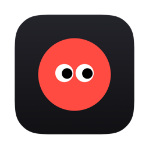
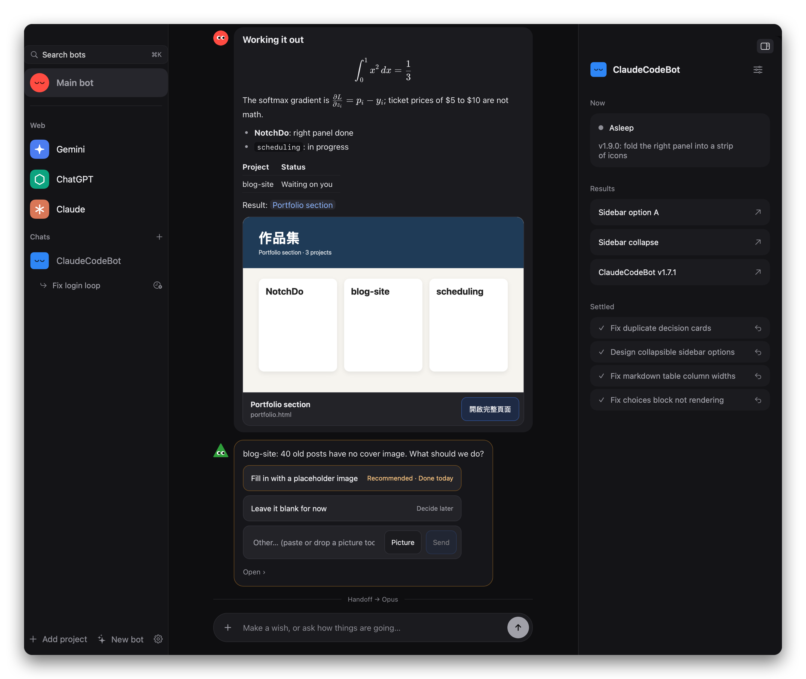
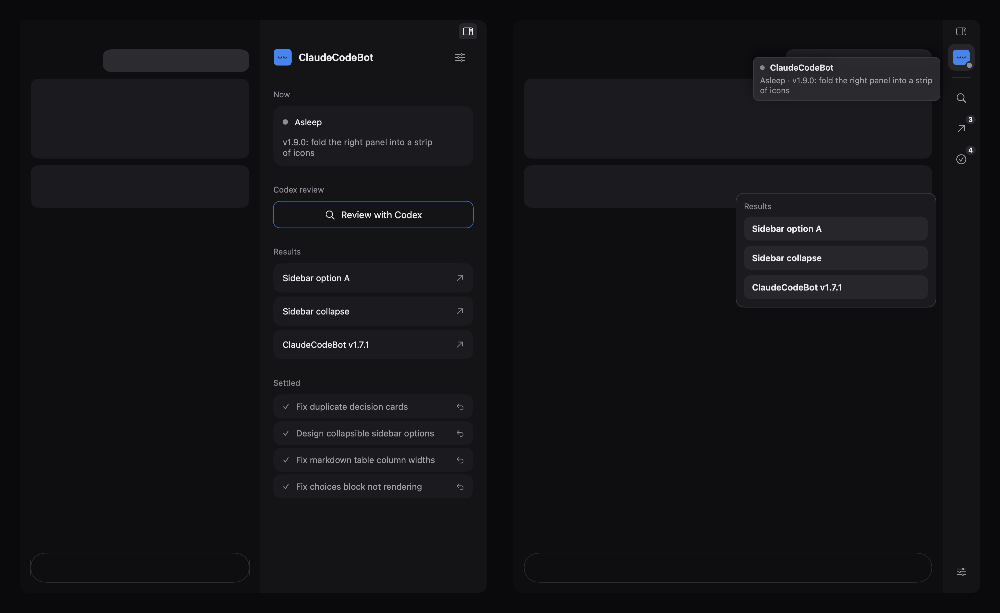
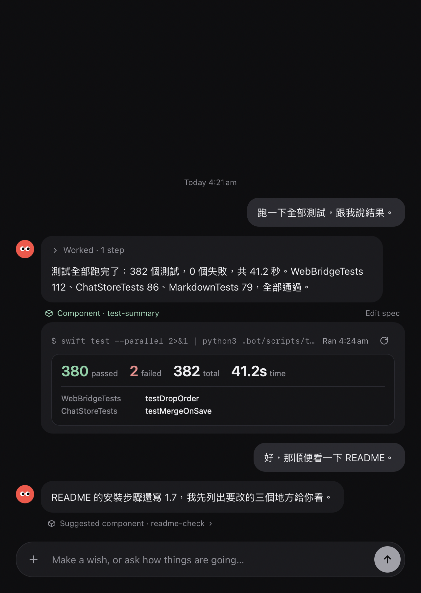
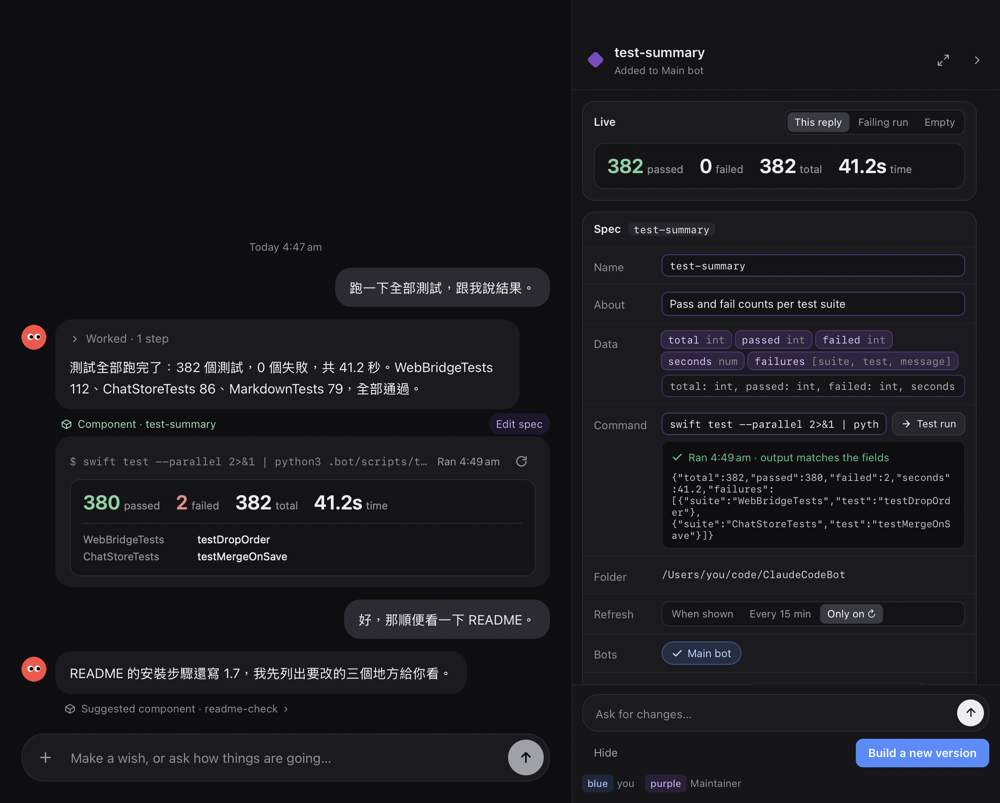
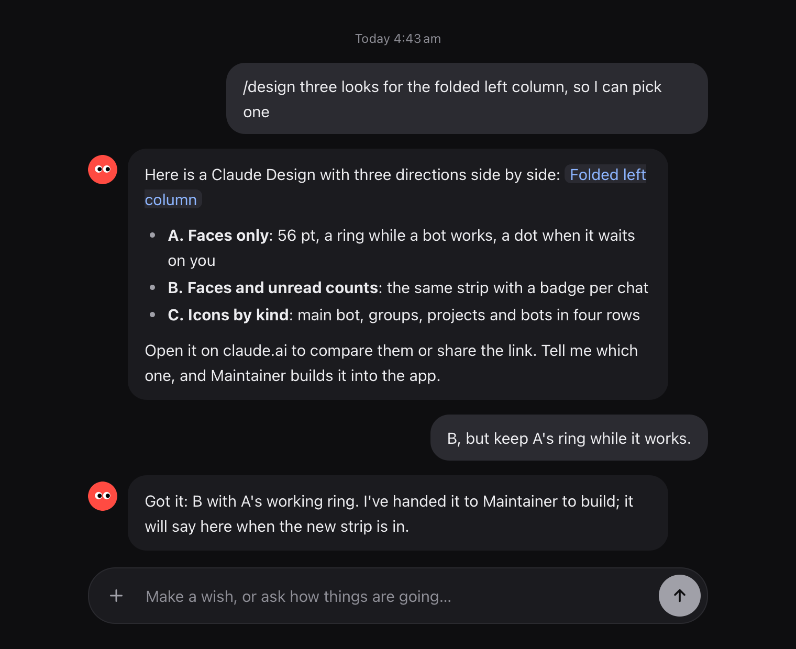
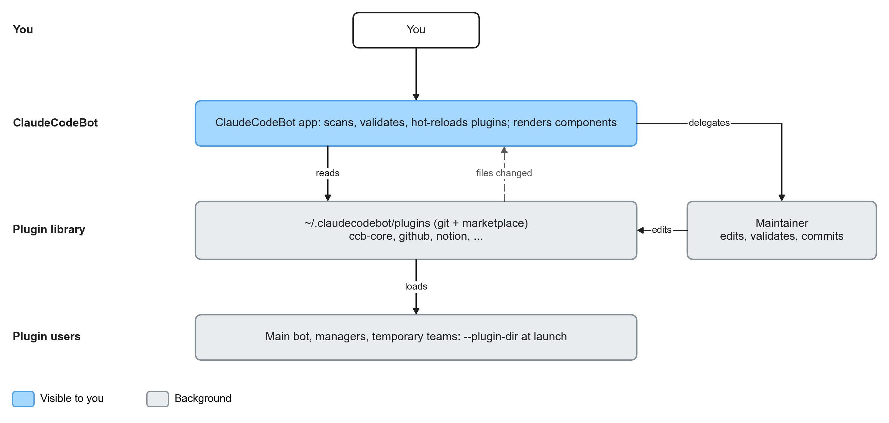
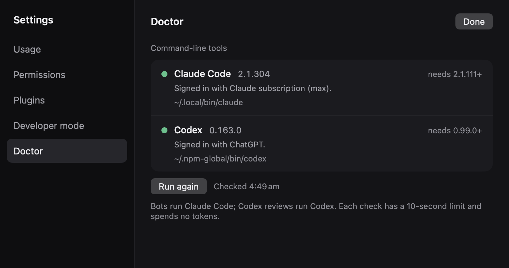

<div align="center">



# ClaudeCodeBot

**A team of Claude Code agents on your Mac, in one chat.**

Hand off real work to background subagents running in parallel, see the results as live
components you can pin, and change the app itself with plugins. All local, on the `claude` CLI
you already have.

[](https://github.com/william1010121/ClaudeCodeBot/releases/latest)
[](https://github.com/william1010121/ClaudeCodeBot/releases)
[](https://github.com/william1010121/ClaudeCodeBot/actions/workflows/ci.yml)
[](LICENSE)
<br>
[](#requirements)
[](Package.swift)
[](https://docs.claude.com/en/docs/claude-code)

[**Download**](https://github.com/william1010121/ClaudeCodeBot/releases/latest) ·
[Quick start](#quick-start) ·
[Features](#features) ·
[Plugins](#plugins--components) ·
[Changelog](CHANGELOG.md)

<br>



</div>

## Why

- **A team that works while you talk.** Real work goes to background subagents running in
  parallel, so the bot is never too busy to answer you.
- **Answers you can see.** Charts and cards drawn right in the chat, one click from becoming a
  pinned chip or a Board tile.
- **An app that changes itself.** Plugins hot-reload, and in developer mode the bot works on
  ClaudeCodeBot's own source.
- **Nothing leaves your Mac but Claude.** It drives the `claude` CLI you already have; chats and
  memory are plain markdown files.
- **In your language.** The app speaks English, 繁體中文, 简体中文, 日本語 and 한국어, and bots
  reply in the language you pick.

## Features

<table>
<tr>
<td width="50%" valign="top">

### 1. A background subagent team

Real work (building, fixing, researching) is handed to subagents that run in the background and
in parallel, so the bot stays free to talk to you. Subagents that change code work in a git
worktree of their own and merge when their tests pass. The right panel shows each one running,
then settled, and a dropped network does not lose them: they carry on where they stopped.

The chat's latest message carries one row for **all background work**: subagents, background
commands, Monitors that watch for events, and scheduled wake-ups or cron jobs (with when they
fire). Press an icon to see the list and each task's last lines of output.

</td>
<td width="50%" valign="top">



</td>
</tr>
<tr>
<td valign="top">



</td>
<td valign="top">

### 2. Components, pins and a Board in the chat

Bots draw small HTML components (charts, cards, test summaries) inside their replies, fed by
their own data or a CLI command (`<show name="…" command="git diff --stat">`). Cards can be
**live** (`Refresh: every 2s`), updated in place by id, and keep their own state
(`ccb.save(data)`, so a todo list's ticks survive a restart).

Pin one above the input box as a status chip, **float** it in a corner over every chat to watch
a build, or lay pins out on a per-bot **Board**: a widget grid where each tile keeps its own
cell, and a drop swaps or pushes tiles down instead of reshuffling everything.

</td>
</tr>
<tr>
<td valign="top">

### 3. One click turns a reply into a component

Press **Make into component** on any reply (or the suggestion chip a bot adds when it sees
something you will ask for again). The bot that wrote the reply writes a brief, and the
Maintainer builds the first version from it, reusing a library component when one already does
the job. The spec panel beside the chat shows the fields, a test run, and each change as it
happens.

</td>
<td valign="top">



</td>
</tr>
<tr>
<td valign="top">



</td>
<td valign="top">

### 4. `/design` gives you a Claude Design to pick from

Say `/design` (or ask for designs to choose from) and the bot makes a
[Claude Design](https://claude.ai) and replies with its shareable claude.ai link. Pick one and
the Maintainer builds that one into the app.

</td>
</tr>
<tr>
<td valign="top">

### 5. Plugins and developer mode: change the app itself

Plugins change the app VS Code style (the input box, how messages are drawn, panels, hooks,
skills and MCP servers) and **hot-reload** when their files change, keeping the last good version
if a new one breaks. Ask the Maintainer to write one for you. Turn on **developer mode** and the
bot works on ClaudeCodeBot's own source: builds, installs (with rollback) and fixes what you
mark "Not right"; send the change back upstream as a [pull request](CONTRIBUTING.md).

</td>
<td valign="top">



</td>
</tr>
<tr>
<td valign="top">



</td>
<td valign="top">

### 6. Everything stays on your Mac

ClaudeCodeBot drives the `claude` CLI already signed in on your Mac: no server, no account of
its own. Chats, memory, routines and the plugin library are plain markdown and text files in
`~/.claudecodebot`; each project's notes live in its git-ignored `.bot/` folder. **Doctor**
shows which `claude` (and `codex`) the bots use and how each is signed in.

</td>
</tr>
</table>

### Also

- **A main bot and one manager per project.** The main bot answers "how is X going?" from each
  manager's `memory.md`, hands work over through project inboxes, and calls up a temporary
  research or prototype team for anything else. Make bots of your own too.
- **Bots that sleep.** Each bot is a long-lived `claude` process that naps after 50 idle minutes,
  writing down what matters first, and wakes when you or a routine need it.
- **Decisions as buttons**, with a recommended option and what each one costs; tool permission
  asks (Allow once / Always / Don't allow) in the chat, with Claude Code's auto mode on by default.
- **Results as claude.ai Artifacts.** Reports, comparisons and previews are published as a
  private claude.ai Artifact and linked in the reply as a card; anything sensitive stays a local
  HTML page. Settings → Permissions → Reports and results picks the rule.
- **A rich chat**: Markdown, LaTeX, tables, images, videos, attachments, replies, group chats,
  result pages as preview cards, and an input box that works with CJK input methods.
- **Call in any bot with `@name`.** It answers in your chat and keeps the work, with its steps,
  in its own chat too.
- **Drafts that stay.** What you typed but did not send stays in each bot's input box across
  switches and restarts.
- **Five languages.** Settings → General → Language: English, 繁體中文, 简体中文, 日本語 or 한국어
  (or follow the Mac), switched at once without a restart. Bots reply in it too; what bots write
  and your own data are never translated.
- **Routines**: a crontab-style `routines.cron` per bot, which bots edit when you ask.
- **Usage at a glance**: today's tokens per bot, rings for the 5-hour and weekly limits, a daily
  budget, per-bot model and effort, and **Doctor** to check your Claude Code and Codex installs.
- **Panels that fold**: the left column into a strip of faces, the right panel into icons.

## Install

1. Download the latest `ClaudeCodeBot-<version>-macOS.zip` from
   [**Releases**](https://github.com/william1010121/ClaudeCodeBot/releases/latest).
2. Unzip it and drag **ClaudeCodeBot.app** to `/Applications`.
3. The app is ad-hoc signed, not notarized. The first time, right-click it → **Open** → **Open**.

The build is universal (Apple silicon and Intel).

### Requirements

| | Version | |
|---|---|---|
| macOS | 14 Sonoma or later | required |
| [Claude Code](https://docs.claude.com/en/docs/claude-code) CLI | **2.1.111** or later, signed in | required: every bot is a `claude` process |
| [Codex](https://github.com/openai/codex) CLI | **0.99.0** or later, signed in | optional: for bots that call `codex` |
| Node.js | any current LTS | recommended: plugins with a program part |
| git | | recommended: the plugin library's history |

**Settings → Doctor** checks both CLIs the way bots find them: version against the minimum, how
each is signed in (no tokens spent), and the latest release on npm, with a one-line fix to copy
when something is off.

## Quick start

1. Open ClaudeCodeBot. If the gear at the bottom of the left column has a red dot, open
   **Settings → Doctor** and fix what it lists (usually `claude auth login`).
2. Say hello to the **Main bot**: "What can you do?"
3. Click **Add project** and pick a folder, or ask the main bot: "Add `~/code/my-app` as a project."
4. Ask for work: "In my-app, fix the failing tests." The main bot hands it to that project's
   manager, which reports back in its own chat (an unread count shows in the left column).
5. Make a group with **+** next to Chats, or a bot of your own with **New bot**.

Your data lives in `~/.claudecodebot` (chats, memory files, routines, the plugin library). Each
project's own notes live in `<project>/.bot/`, which is git-ignored.

## How it works


- **The shell** is SwiftUI: the left column lists the main bot, your groups, projects and bots;
  the right column shows what is going on, what waits for you, results and settings.
- **The chat** in the middle is a web page (TypeScript, markdown-it, KaTeX, CodeMirror 6) in a
  `WKWebView`, which is also where plugins' web parts run.
- **Each bot** is one long-lived `claude -p --input-format stream-json --output-format stream-json`
  process. Bots talk back through a few tags in their replies (`<choices>`, `<team>`, `<show>`,
  `<component>`, `<plugin>`, `<install>`), which the app turns into buttons, teams and requests.
- **Memory** is plain markdown: `memory.md` with four sections, an `inbox.md` per project, and
  `routines.cron`. Bots stay inside the one-hour prompt-cache window while awake and write their
  memory before they sleep.

More detail: [docs/PRD.md](docs/PRD.md) (the app) and [docs/PRD-v2.md](docs/PRD-v2.md) (plugins).

## Plugins & components

Plugins change the app itself, VS Code style. A plugin is a folder in
`~/.claudecodebot/plugins/` with an npm `package.json` whose `ccb` field declares up to three parts:

- a **web part** that changes the input box, how messages are drawn, components and right-column panels;
- a **program part** in a Node plugin host (hooks such as `beforeSend`, commands, routines, storage);
- a **Claude part** (skills, agents, MCP servers) handed to every bot with `--plugin-dir`.

```json
{
  "name": "ccb-example",
  "version": "1.0.0",
  "engines": { "ccb": "^2.0.0" },
  "ccb": {
    "permissions": ["composer"],
    "web": "dist/web.js",
    "contributes": {
      "commands": [{ "id": "example.run", "title": "Run it", "key": "cmd+shift+e" }]
    }
  }
}
```

```js
// dist/web.js (an ES module)
export function activate(ccb) {
  ccb.composer.onKeyDown((event) => { /* … */ });
  ccb.messages.use((md) => { /* a markdown-it plugin */ });
  ccb.commands.register("example.run", () => ccb.notify("Hello from a plugin"));
}
```

The full API (web part, program part, Claude part, components, panels, settings and secrets) is
in the `PLUGINS.md` the app writes into the plugin library on launch. Check a plugin with:

```bash
/Applications/ClaudeCodeBot.app/Contents/MacOS/ClaudeCodeBot --check-plugin path/to/plugin
```

Or ask the Maintainer to write it for you; it can also turn one of your own projects into a
plugin, asking before it reads the folder. **External plugins** from git, npm or a zip are
installed only after you approve a card listing their source, license, permissions and MCP
servers. Secrets go to the macOS keychain.

## Developer mode & contributing

ClaudeCodeBot can work on itself. Turn on **Settings → Developer mode** (off by default) and pick
the project that is your ClaudeCodeBot checkout. Its manager may then install a new build of the
app after you confirm (a build that does not come up within 90 seconds is rolled back), look at
the app's window, and receives the replies you mark "Not right" in any chat.

Contributions are welcome: see [CONTRIBUTING.md](CONTRIBUTING.md) for the PR flow, and
[SECURITY.md](SECURITY.md) to report a vulnerability.

## Build from source

Swift 6.2 (Xcode 26) is needed. The web chat is prebuilt and committed in
`Sources/ClaudeCodeBot/Resources`, so `swift build` does not need npm.

```bash
git clone https://github.com/william1010121/ClaudeCodeBot.git
cd ClaudeCodeBot
swift run ClaudeCodeBot          # build and run a debug build
scripts/make-app.sh              # or build dist/ClaudeCodeBot.app and its zip (version from VERSION)
SINGLE_ARCH=1 scripts/make-app.sh   # faster: this Mac's architecture only
```

Working on the chat surface, plugins or tests:

```bash
cd Web && npm ci && npm test && npm run build        # chat surface, built-in plugins, plugin host
swift test                                           # app tests (with a fake claude)
CCB_LIVE=1 swift test --filter Live                  # acceptance tests with the real claude (costs tokens)
CCB_SNAPSHOT=/tmp/chat.png swift run ClaudeCodeBot   # render a sample chat to a PNG and quit
```

| Path | What |
|---|---|
| `Sources/ClaudeCodeBotCore` | Bots, workspace, routines, components, plugin registry, plugin host client, installer |
| `Sources/ClaudeCodeBot` | The SwiftUI app and the web view bridge |
| `Web/src` | The chat surface (TypeScript) |
| `Web/host` | The Node plugin host |
| `Web/plugins` | Built-in plugins (`ccb-latex`) |
| `docs/` | Product docs, flowcharts and README images |

The screenshots in this README are drawn by the app's own snapshot mode (`CCB_SNAPSHOT`,
`CCB_RAIL_SNAPSHOT`, `CCB_RIGHT_SNAPSHOT`, `CCB_SPEC_SNAPSHOT`,
`CCB_SETTINGS_SNAPSHOT`) with sample data; `scripts/make-hero.swift` puts the hero picture
together from them.

## Versioning & releases

ClaudeCodeBot uses [semantic versioning](https://semver.org); the current version is in
[`VERSION`](VERSION) and every change is in [CHANGELOG.md](CHANGELOG.md). Pushing a `v<version>`
tag runs the [release workflow](.github/workflows/release.yml), which tests, builds the universal
app and publishes it on [GitHub Releases](https://github.com/william1010121/ClaudeCodeBot/releases).

## License

[GPL-3.0-or-later](LICENSE) © william1010121: you may redistribute and modify ClaudeCodeBot under
the GNU General Public License, version 3 or (at your option) any later version. Releases up to
and including 1.14.2 were MIT-licensed.

The built-in plugins bundle KaTeX, markdown-it and CodeMirror (all MIT). The web bots' LaTeX
snippets and live preview are [web-laas](https://github.com/william1010121/web-laas)
(GPL-3.0-or-later), which bundles MathJax and mhchemParser (Apache-2.0); their notices ship in
the app as
[`web-laas/THIRD_PARTY_NOTICES.txt`](Sources/ClaudeCodeBot/Resources/web-laas/THIRD_PARTY_NOTICES.txt),
rebuilt by `scripts/build-web-laas.sh`.

ClaudeCodeBot is an independent project and is not affiliated with Anthropic or OpenAI.
