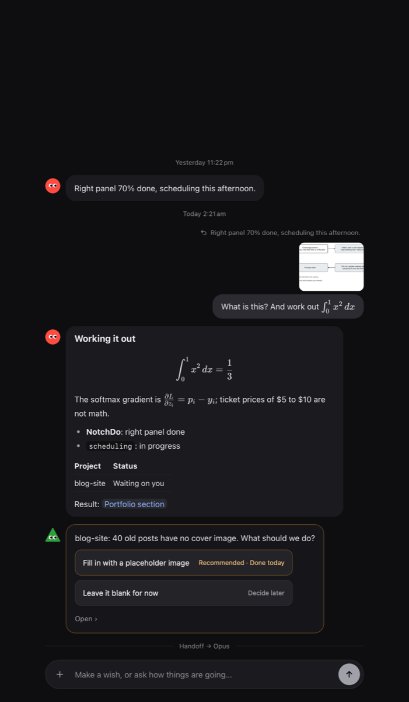
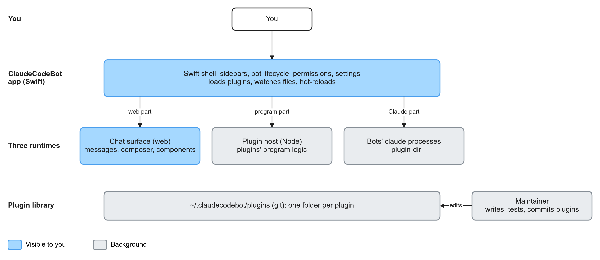

# ClaudeCodeBot

[](https://github.com/william1010121/ClaudeCodeBot/actions/workflows/ci.yml)
[](https://github.com/william1010121/ClaudeCodeBot/releases)
[](LICENSE)

**A Grok-style front desk for your local Claude Code agents, on macOS.**

You talk to one main bot. It answers from what your project managers remember, hands work to the
right project, pulls up a temporary team for anything else, and comes back with a short answer and
a link to the result. Bots sleep when idle, write down what matters, and wake up when you need them.



## What it does

- **Main bot**: your front desk. It wakes on a message, works in a long-lived `claude` session, and
  after 50 idle minutes writes what matters into `memory.md` and goes to sleep (its face closes its eyes).
- **One manager per project**: add a folder and it gets a manager that works there. The main bot
  reads managers' memory files to answer "how is X going?" without waking them, and hands work over
  through each project's inbox.
- **Temporary teams**: a wish that belongs to no project goes to a research or prototype team, which
  hands back a one-page result.
- **Only interrupts when it should**: managers report when they finish or get stuck; when you need to
  decide, buttons appear (with a recommended option and what each one costs).
- **Bots of their own**: a morning news bot or a reading coach, with its own memory and routines
  (New bot in the left column, ask the main bot, or `ccb.bots.create` from a plugin).
- **Asks before using a tool it may not use**: Allow once / Always allow / Don't allow, in the chat.
- **Routines**: each bot has a crontab-style `routines.cron` (bots edit it themselves when you ask).
- **Chat**: Markdown, LaTeX (KaTeX), images and videos, attachments, replies to a message, and an
  input box that works with Chinese and Japanese input methods.
- **Plugins for the app itself**, VS Code style (`package.json` with a `ccb` field):
  - a **web part** that changes the input box, how messages are drawn, components and right-column panels;
  - a **program part** in a Node plugin host (hooks such as `beforeSend`, commands, routines, storage);
  - a **Claude part** (skills, agents, MCP servers) handed to every bot with `--plugin-dir`.
- **The Maintainer**: a built-in project that maintains the plugin library (a git repo). Report a
  problem next to a component, or ask in chat, and it edits, checks, commits and tags the plugin;
  the app hot-reloads it and keeps the last good version if a new one breaks. It can turn one of your
  own projects into a plugin, asking before it reads the folder.
- **External plugins** from git, npm or a zip are installed only after you approve a card listing
  their source, license, permissions and MCP servers. Secrets go to the macOS keychain.

## Install

1. Download the latest `ClaudeCodeBot-…-macOS.zip` from
   [Releases](https://github.com/william1010121/ClaudeCodeBot/releases), unzip it and drag
   **ClaudeCodeBot.app** to `/Applications`.
2. The app is ad-hoc signed, not notarized. The first time, right-click it → **Open** → **Open**.

Requirements:

- macOS 14 or later
- [Claude Code](https://docs.claude.com/en/docs/claude-code) installed and logged in (`claude` on your PATH)
- Recommended: **Node.js** (plugins with a program part) and **git** (the plugin library's history)

Your data lives in `~/.claudecodebot` (chats, memory files, routines, the plugin library). Each
project's own notes live in `<project>/.bot/`, which is git-ignored.

### Build from source

```bash
git clone https://github.com/william1010121/ClaudeCodeBot.git
cd ClaudeCodeBot
swift run ClaudeCodeBot          # run it
scripts/make-app.sh              # or build dist/ClaudeCodeBot.app (version from VERSION)
```

Swift 6.2 (Xcode 26) is needed. The web chat is prebuilt and committed in
`Sources/ClaudeCodeBot/Resources`, so `swift build` does not need npm.

## How it works



- **The shell** is SwiftUI: the left column lists the main bot and your projects; the right column
  shows what is going on, what waits for you, results and settings.
- **The chat** in the middle is a web page (TypeScript, markdown-it, KaTeX, CodeMirror 6) in a
  `WKWebView`, which is also where plugins' web parts run.
- **Each bot** is one long-lived `claude -p --input-format stream-json --output-format stream-json`
  process. Bots talk back through a few tags in their replies (`<choices>`, `<team>`, `<show>`,
  `<component>`, `<plugin>`, `<install>`), which the app turns into buttons, teams and requests.
- **Memory** is plain markdown: `memory.md` with four sections, an `inbox.md` per project, and
  `routines.cron`. Bots stay inside the one-hour prompt-cache window while awake and write their
  memory before they sleep.

What changed in each version: [CHANGELOG.md](CHANGELOG.md).

More detail: [docs/PRD.md](docs/PRD.md) (the app) and [docs/PRD-v2.md](docs/PRD-v2.md) (plugins).

## Writing plugins

A plugin is a folder in `~/.claudecodebot/plugins/` with an npm `package.json`:

```json
{
  "name": "ccb-example",
  "version": "1.0.0",
  "engines": { "ccb": "^2.0.0" },
  "ccb": {
    "permissions": ["composer"],
    "web": "dist/web.js",
    "contributes": {
      "commands": [{ "id": "example.run", "title": "Run it", "key": "cmd+shift+e" }]
    }
  }
}
```

```js
// dist/web.js (an ES module)
export function activate(ccb) {
  ccb.composer.onKeyDown((event) => { /* … */ });
  ccb.messages.use((md) => { /* a markdown-it plugin */ });
  ccb.commands.register("example.run", () => ccb.notify("Hello from a plugin"));
}
```

The full API (web part, program part, Claude part, components, panels, settings and secrets) is in
the `PLUGINS.md` the app writes into the plugin library. Check a plugin with:

```bash
/Applications/ClaudeCodeBot.app/Contents/MacOS/ClaudeCodeBot --check-plugin path/to/plugin
```

Or ask the Maintainer to write it for you.

## Development

```bash
cd Web && npm ci && npm test && npm run build        # chat surface, built-in plugins, plugin host
swift test                                           # app tests (with a fake claude)
CCB_LIVE=1 swift test --filter Live                  # acceptance tests with the real claude (costs tokens)
CCB_SNAPSHOT=/tmp/chat.png swift run ClaudeCodeBot   # render the chat to a PNG and quit
```

| Path | What |
|---|---|
| `Sources/ClaudeCodeBotCore` | Bots, workspace, routines, components, plugin registry, plugin host client, installer |
| `Sources/ClaudeCodeBot` | The SwiftUI app and the web view bridge |
| `Web/src` | The chat surface (TypeScript) |
| `Web/host` | The Node plugin host |
| `Web/plugins` | Built-in plugins (`ccb-latex`) |
| `docs/` | Product docs and flowcharts |

## License

[MIT](LICENSE). The built-in plugins bundle KaTeX, markdown-it and CodeMirror (all MIT).
