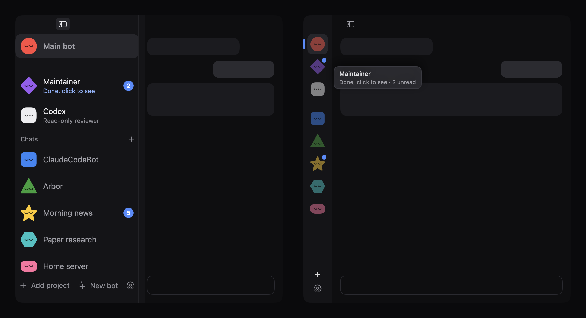
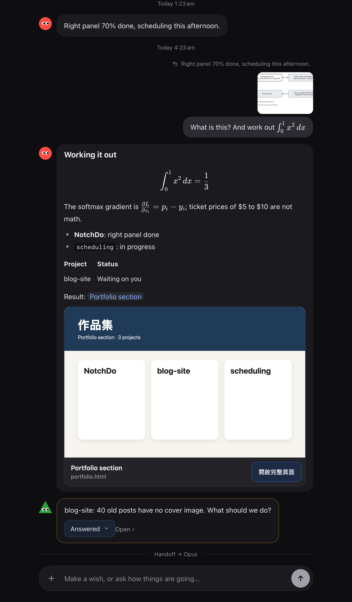
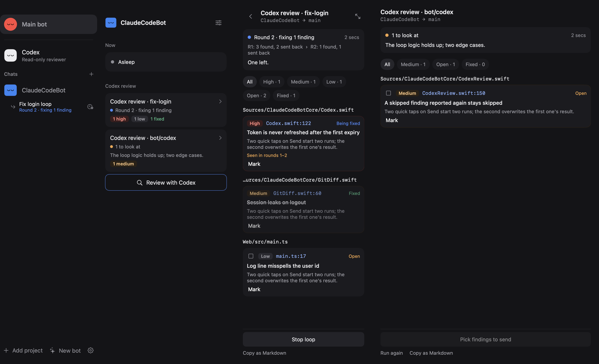

<div align="center">


# ClaudeCodeBot

**A front desk for your local Claude Code agents, on macOS.**

Talk to one main bot. It knows what every project is up to, hands work to the right one,
and only interrupts you when something needs a decision.

[](https://github.com/william1010121/ClaudeCodeBot/releases/latest)
[](https://github.com/william1010121/ClaudeCodeBot/releases)
[](https://github.com/william1010121/ClaudeCodeBot/actions/workflows/ci.yml)
[](LICENSE)
<br>
[](#requirements)
[](Package.swift)
[](https://docs.claude.com/en/docs/claude-code)

[**Download**](https://github.com/william1010121/ClaudeCodeBot/releases/latest) ·
[Quick start](#quick-start) ·
[Features](#features) ·
[Plugins](#plugins--components) ·
[Changelog](CHANGELOG.md)

<br>


</div>

## Why

Running several Claude Code sessions means juggling terminals, remembering which one was doing
what, and checking back on each. ClaudeCodeBot puts a messenger-style app in front of them:

- **One place to ask.** The main bot answers "how is X going?" from the managers' memory files,
  without waking them.
- **Bots that sleep.** Each bot is a long-lived `claude` process that naps after 50 idle minutes,
  writing down what matters first, and wakes when you (or a routine) need it.
- **Interruptions that earn it.** Bots report in their own chats; when you need to decide, you
  get buttons with a recommended option and what each one costs.
- **Everything stays local.** It drives the `claude` CLI already on your Mac; chats and memory are
  plain files in `~/.claudecodebot`.

## Features

<table>
<tr>
<td width="50%" valign="top">

### A main bot and one manager per project

Add a folder and it gets a manager that works there. The main bot reads every manager's
`memory.md`, hands work over through each project's inbox, and calls up a temporary research or
prototype team for anything that belongs to no project. Make bots of your own too, like a
morning news bot, with their own memory and routines.

</td>
<td width="50%" valign="top">



</td>
</tr>
<tr>
<td valign="top">



</td>
<td valign="top">

### A chat that does more than text

Markdown, LaTeX (KaTeX), tables, images and videos, attachments, replies to a message, and an
input box that works with Chinese and Japanese input methods. Result pages show as preview
cards and open in windows of their own. Each reply folds the tool steps behind it. Group chats
work like a messenger: `@name` talks to one bot; without an @, every member reads and answers
only if it has something to add.

</td>
</tr>
<tr>
<td valign="top">

### Components, pins and a Board

A bot can show a small HTML component in a reply, fed by a CLI command
(`<show name="…" command="git diff --stat">`). Make any reply into a component, pin it above the
input box as a status chip, or lay pins out on a per-bot **Board**, a widget grid.

</td>
<td valign="top">


</td>
</tr>
<tr>
<td valign="top">



</td>
<td valign="top">

### Code review by Codex (optional)

With the [Codex CLI](https://github.com/openai/codex) installed, **Review with Codex** in a
project's right panel runs a read-only review of uncommitted changes or a commit and opens a
report: findings by file, filters by severity, send picked ones back to the bot, mark fixed,
run again. A per-bot review loop can have Codex check subagents' work until it is clean.

</td>
</tr>
<tr>
<td valign="top">

### What is going on, at a glance

The right panel shows what a bot is doing now, its results and the subagents it settled. Fold it
(and the left column) into a strip of icons when you want the chat wide.

</td>
<td valign="top">


</td>
</tr>
</table>

And also:

- **Asks before using a tool it may not use**: Allow once / Always allow / Don't allow, in the chat.
  Safe actions can be auto-approved (Claude Code's auto mode, on by default).
- **Routines**: each bot has a crontab-style `routines.cron`, which bots edit themselves when you ask.
- **Settings**: today's tokens and cost per bot, a daily budget, per-bot model and thinking effort,
  permissions, plugins, and **Doctor**, which checks your Claude Code and Codex installs.
- **The Maintainer**: a built-in project that keeps the plugin library (a git repo). Report a
  problem next to a component, or ask in chat, and it edits, checks, commits and tags the
  plugin; the app hot-reloads it and keeps the last good version if a new one breaks.

## Install

1. Download the latest `ClaudeCodeBot-<version>-macOS.zip` from
   [**Releases**](https://github.com/william1010121/ClaudeCodeBot/releases/latest).
2. Unzip it and drag **ClaudeCodeBot.app** to `/Applications`.
3. The app is ad-hoc signed, not notarized. The first time, right-click it → **Open** → **Open**.

The build is universal (Apple silicon and Intel).

### Requirements

| | Version | |
|---|---|---|
| macOS | 14 Sonoma or later | required |
| [Claude Code](https://docs.claude.com/en/docs/claude-code) CLI | **2.1.111** or later, signed in | required: every bot is a `claude` process |
| [Codex](https://github.com/openai/codex) CLI | **0.99.0** or later, signed in | optional: only for Codex reviews |
| Node.js | any current LTS | recommended: plugins with a program part |
| git | | recommended: the plugin library's history |

**Settings → Doctor** checks both CLIs the way bots find them: version against the minimum, how
each is signed in (no tokens spent), and the latest release on npm, with a one-line fix to copy
when something is off.

## Quick start

1. Open ClaudeCodeBot. If the gear at the bottom of the left column has a red dot, open
   **Settings → Doctor** and fix what it lists (usually `claude auth login`).
2. Say hello to the **Main bot**: "What can you do?"
3. Click **Add project** and pick a folder, or ask the main bot: "Add `~/code/my-app` as a project."
4. Ask for work: "In my-app, fix the failing tests." The main bot hands it to that project's
   manager, which reports back in its own chat (an unread count shows in the left column).
5. Make a group with **+** next to Chats, or a bot of your own with **New bot**.

Your data lives in `~/.claudecodebot` (chats, memory files, routines, the plugin library). Each
project's own notes live in `<project>/.bot/`, which is git-ignored.

## How it works


- **The shell** is SwiftUI: the left column lists the main bot, your groups, projects and bots;
  the right column shows what is going on, what waits for you, results and settings.
- **The chat** in the middle is a web page (TypeScript, markdown-it, KaTeX, CodeMirror 6) in a
  `WKWebView`, which is also where plugins' web parts run.
- **Each bot** is one long-lived `claude -p --input-format stream-json --output-format stream-json`
  process. Bots talk back through a few tags in their replies (`<choices>`, `<team>`, `<show>`,
  `<component>`, `<plugin>`, `<install>`), which the app turns into buttons, teams and requests.
- **Memory** is plain markdown: `memory.md` with four sections, an `inbox.md` per project, and
  `routines.cron`. Bots stay inside the one-hour prompt-cache window while awake and write their
  memory before they sleep.

More detail: [docs/PRD.md](docs/PRD.md) (the app) and [docs/PRD-v2.md](docs/PRD-v2.md) (plugins).

## Plugins & components

Plugins change the app itself, VS Code style. A plugin is a folder in
`~/.claudecodebot/plugins/` with an npm `package.json` whose `ccb` field declares up to three parts:

- a **web part** that changes the input box, how messages are drawn, components and right-column panels;
- a **program part** in a Node plugin host (hooks such as `beforeSend`, commands, routines, storage);
- a **Claude part** (skills, agents, MCP servers) handed to every bot with `--plugin-dir`.

```json
{
  "name": "ccb-example",
  "version": "1.0.0",
  "engines": { "ccb": "^2.0.0" },
  "ccb": {
    "permissions": ["composer"],
    "web": "dist/web.js",
    "contributes": {
      "commands": [{ "id": "example.run", "title": "Run it", "key": "cmd+shift+e" }]
    }
  }
}
```

```js
// dist/web.js (an ES module)
export function activate(ccb) {
  ccb.composer.onKeyDown((event) => { /* … */ });
  ccb.messages.use((md) => { /* a markdown-it plugin */ });
  ccb.commands.register("example.run", () => ccb.notify("Hello from a plugin"));
}
```

The full API (web part, program part, Claude part, components, panels, settings and secrets) is
in the `PLUGINS.md` the app writes into the plugin library on launch. Check a plugin with:

```bash
/Applications/ClaudeCodeBot.app/Contents/MacOS/ClaudeCodeBot --check-plugin path/to/plugin
```

Or ask the Maintainer to write it for you; it can also turn one of your own projects into a
plugin, asking before it reads the folder. **External plugins** from git, npm or a zip are
installed only after you approve a card listing their source, license, permissions and MCP
servers. Secrets go to the macOS keychain.

## Developer mode & contributing

ClaudeCodeBot can work on itself. Turn on **Settings → Developer mode** (off by default) and pick
the project that is your ClaudeCodeBot checkout. Its manager may then install a new build of the
app after you confirm (a build that does not come up within 90 seconds is rolled back), look at
the app's window, and receives the replies you mark "Not right" in any chat.

Contributions are welcome: see [CONTRIBUTING.md](CONTRIBUTING.md) for the PR flow, and
[SECURITY.md](SECURITY.md) to report a vulnerability.

## Build from source

Swift 6.2 (Xcode 26) is needed. The web chat is prebuilt and committed in
`Sources/ClaudeCodeBot/Resources`, so `swift build` does not need npm.

```bash
git clone https://github.com/william1010121/ClaudeCodeBot.git
cd ClaudeCodeBot
swift run ClaudeCodeBot          # build and run a debug build
scripts/make-app.sh              # or build dist/ClaudeCodeBot.app and its zip (version from VERSION)
SINGLE_ARCH=1 scripts/make-app.sh   # faster: this Mac's architecture only
```

Working on the chat surface, plugins or tests:

```bash
cd Web && npm ci && npm test && npm run build        # chat surface, built-in plugins, plugin host
swift test                                           # app tests (with a fake claude)
CCB_LIVE=1 swift test --filter Live                  # acceptance tests with the real claude (costs tokens)
CCB_SNAPSHOT=/tmp/chat.png swift run ClaudeCodeBot   # render a sample chat to a PNG and quit
```

| Path | What |
|---|---|
| `Sources/ClaudeCodeBotCore` | Bots, workspace, routines, components, plugin registry, plugin host client, installer |
| `Sources/ClaudeCodeBot` | The SwiftUI app and the web view bridge |
| `Web/src` | The chat surface (TypeScript) |
| `Web/host` | The Node plugin host |
| `Web/plugins` | Built-in plugins (`ccb-latex`) |
| `docs/` | Product docs, flowcharts and README images |

The screenshots in this README are drawn by the app's own snapshot mode (`CCB_SNAPSHOT`,
`CCB_RAIL_SNAPSHOT`, `CCB_RIGHT_SNAPSHOT`, `CCB_CODEX_SNAPSHOT`, `CCB_SPEC_SNAPSHOT`) with
sample data.

## Versioning & releases

ClaudeCodeBot uses [semantic versioning](https://semver.org); the current version is in
[`VERSION`](VERSION) and every change is in [CHANGELOG.md](CHANGELOG.md). Pushing a `v<version>`
tag runs the [release workflow](.github/workflows/release.yml), which tests, builds the universal
app and publishes it on [GitHub Releases](https://github.com/william1010121/ClaudeCodeBot/releases).

## License

[MIT](LICENSE) © william1010121. The built-in plugins bundle KaTeX, markdown-it and CodeMirror (all MIT).

ClaudeCodeBot is an independent project and is not affiliated with Anthropic or OpenAI.
