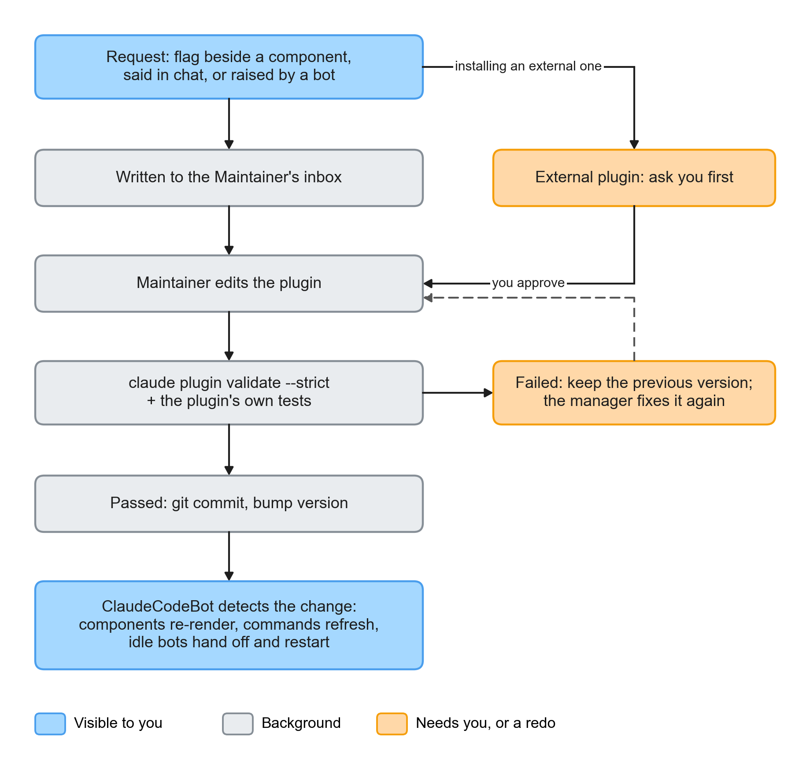
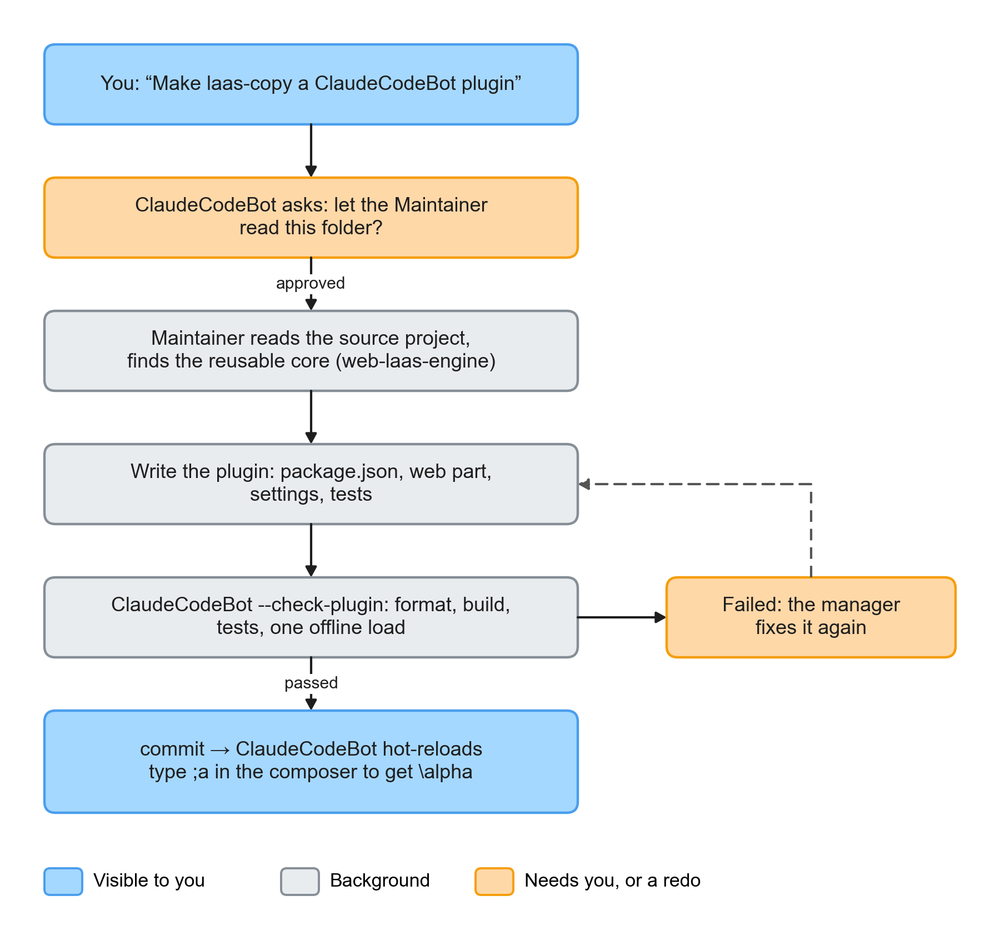

# PRD v2: ClaudeCodeBot's plugin system, LaTeX, and self-maintenance

> **Note:** milestones P1–P7 in this document have since been implemented. The text below is kept as the original plan.

> Version: v2 · 2026-10-19 · Replaces the earlier v2 draft; follows [PRD.md](PRD.md) (v1, M1–M6 done)
> Status at the time of writing: planning, no code written yet
> Technology: stays **Swift** (macOS app)

---

## 1. In one sentence

Every capability of ClaudeCodeBot can be a **plugin**. A plugin can change ClaudeCodeBot itself: the composer, how messages are rendered, components, panels, commands, bot behavior; it can also bring Claude Code skills, agents, and MCP servers. This is powerful enough to move something like web-laas, an add-on that "lets web editors type LaTeX", straight into ClaudeCodeBot's composer. Plugins are written, tested, and maintained by the "**Maintainer**" manager, and once a plugin is updated ClaudeCodeBot re-renders without restarting.

---

## 2. Why

| Current problem | Consequence |
|---|---|
| The only thing that can be extended is "components" (an HTML template) | Changing the composer, adding LaTeX, adding a panel all have to wait for me to change Swift |
| Messages are drawn directly in SwiftUI | Things that already exist on the web, like math, charts, and syntax highlighting, all have to be rebuilt |
| The component team can only change components | As soon as a request goes beyond components, nobody can take it, e.g. "hook laas in" |
| No concept of plugins | You can't install something someone else made, nor disable, roll back, or upgrade it |

---

## 3. Goals and non-goals

**Goals**

1. **LaTeX**: math in both the bot's messages and yours is rendered as typeset formulas.
2. **Powerful plugins**: plugins can change ClaudeCodeBot's UI and behavior, not just Claude Code's configuration. The acceptance bar: web-laas can become a ClaudeCodeBot plugin and work properly in the composer.
3. **ClaudeCodeBot maintains its own plugins**: you say "make laas-copy a plugin", and the Maintainer reads the original project, writes the plugin, tests it, and installs it.
4. **Hot reload**: once a plugin is updated, ClaudeCodeBot reloads it automatically and re-renders in place, without restarting the app.
5. **A broken plugin doesn't bring ClaudeCodeBot down**: when a plugin fails, only that plugin is disabled and the app keeps working.
6. **The screen stays just as sparse**: plugins don't add clutter to the screen and follow the "3–4 things per page" principle.

**Not in this version**

- Switching to Electron or another cross-platform framework. Stays Swift, macOS only.
- A plugin store browsing page. For now, install by pasting a URL or a folder path.
- Long-term compatibility guarantees for the plugin API. The v2 API is marked `0.x` and may change.
- Letting the Maintainer change the ClaudeCodeBot core (Swift). The core is still changed by me.

---

## 4. Scenarios

**Scenario A: asking about math**
You ask the main bot "derive the gradient of softmax". In the reply, `$\frac{\partial L}{\partial z_i} = p_i - y_i$` is rendered as a typeset formula, and `$$…$$` gets its own centered line. Copying a formula gives you the LaTeX source.

**Scenario B: turning laas into a ClaudeCodeBot plugin**
1. You say "make ~/code/laas-copy a ClaudeCodeBot plugin".
2. ClaudeCodeBot first asks you: "Let the Maintainer read this folder?" You click "OK".
3. A "Maintainer · building plugin" row appears in the left column; click it to see what it's doing right now.
4. A few minutes later, a line appears in the main bot's conversation: "Plugin ccb-laas 0.1.0: you can now type LaTeX with laas in the composer".
5. You type `;a` in the composer and it becomes `\alpha`; a live preview of the formula appears next to the cursor.

**Scenario C: a plugin breaks**
You ask it to change the laas plugin's shortcut, it breaks the plugin, and loading fails. ClaudeCodeBot doesn't adopt the new version, keeps using the previous one, and hands the error back to the Maintainer. The change takes effect only after it's fixed. You don't have to deal with any of it.

**Scenario D: installing an external plugin**
You paste a GitHub URL. The Maintainer first lists what the plugin will do and what permissions it needs (for example "read and write your files", "access the network", "run code in the composer"), and asks you with an option card. It's installed only if you agree.

**Scenario E: component feedback (extending v1)**
You click the flag beside a multiple-choice component and report "add an Other option". This goes to the Maintainer, which changes the `ccb-choices` plugin, and the multiple-choice component in the conversation is swapped for the new version in place.

---

## 5. Architecture


ClaudeCodeBot is split into a Swift shell plus three runtimes:

| Part | What it is | Responsible for |
|---|---|---|
| **Swift shell** | The current ClaudeCodeBot app | Left and right columns, settings, bot lifecycle (wake, sleep, handoff), process management, permissions, plugin loading and hot reload |
| **Chat surface** | A web view (WKWebView) | Rendering messages, the composer, components. A plugin's "web part" runs here |
| **Plugin host** | A Node process (Node v24 is already installed locally) | Runs a plugin's "program part": commands, bot hooks, file I/O, network. Works the same way as VS Code's extension host |
| **Bots' claude processes** | The existing bots | A plugin's "Claude part" (skills, agents, MCP) is loaded with `--plugin-dir`; tested and works |

**The biggest change this time: the chat surface becomes a web page.** Why:
- Ready-made tools like laas, KaTeX, markdown-it, and CodeMirror are all web code; inside a web view they work directly, with no rewrite.
- The most natural way for a plugin to change the UI is to change a web page. VS Code and Obsidian both work this way.
- The shell is still Swift. The left and right columns, settings, and bot management stay as they are.

---

## 6. What a plugin looks like

### 6.1 Folder

```
~/.claudecodebot/plugins/        ← plugin library, the whole thing is one git repo
└── ccb-laas/                    ← one folder per plugin
    ├── package.json             ← plugin manifest (standard npm format + "ccb" field)
    ├── dist/web.js              ← web part: runs in the chat surface
    ├── dist/host.js             ← program part: runs in the plugin host (optional)
    ├── claude/                  ← Claude part (optional): a standard Claude Code plugin
    │   ├── .claude-plugin/plugin.json
    │   ├── skills/  agents/  .mcp.json
    ├── test/                    ← the plugin's own tests
    └── README.md
```

### 6.2 package.json

The plugin manifest is npm's `package.json`. This matches the VS Code extension format, so plugins can also be published to and installed from npm.

```json
{
  "name": "ccb-laas",
  "displayName": "LaTeX quick typing (laas)",
  "version": "0.1.0",
  "description": "Type LaTeX in the composer the Emacs laas + cdlatex way.",
  "license": "GPL-3.0-or-later",
  "engines": { "ccb": "^2.0.0" },
  "ccb": {
    "permissions": ["composer"],
    "web": "dist/web.js",
    "contributes": {
      "composer": [{ "id": "laas" }],
      "commands": [
        { "id": "laas.toggle", "title": "Toggle LaTeX quick typing", "key": "cmd+shift+l" }
      ],
      "settings": {
        "laas.autoSpace": { "type": "boolean", "default": true, "title": "Insert spaces automatically" },
        "laas.delimiter": { "type": "enum", "options": ["$…$", "\\(…\\)"], "default": "$…$", "title": "Inline math delimiter" }
      }
    }
  },
  "dependencies": { "web-laas-engine": "^0.6.0" }
}
```

### 6.3 What a plugin can add (extension points)

| Extension point | Where it runs | What it can do | Example |
|---|---|---|---|
| `composer` | Chat surface | Listen to keys, change text, insert content, show a floating preview next to the cursor | laas: `;a` → `\alpha` |
| `renderers` (how messages are drawn) | Chat surface | Add markdown-it plugins, or modify the DOM after a message renders | LaTeX (KaTeX), Mermaid diagrams, syntax highlighting |
| `components` | Chat surface | Interactive elements the bot calls up with `<show>` or `<choices>` | Multiple choice, progress bar |
| `panels` | Chat surface (right-column subpage) | Adds a subpage to the right column, with web content | A plugin's settings page, data charts |
| `commands` | Plugin host or chat surface | A named action; typing `/` in the composer lists them, and they can be bound to shortcuts | `/laas.toggle`, `/export-chat` |
| `hooks` (bot hooks) | Plugin host | Before sending, after a reply, on wake, before sleep: can modify content or block it | Normalize `\(…\)` to `$…$` before sending |
| `routines` | Plugin host | Add scheduled jobs, written into the bot's `routines.cron` | Back up the plugin library weekly |
| `settings` | Shell | Declare settings; ClaudeCodeBot generates toggles and menus in the settings subpage automatically | laas's auto-spacing |
| `claude` (Claude part) | Bot process | Skills, agents (temporary teams), MCP, hooks | Research team, GitHub MCP |

### 6.4 Plugin API (draft)

**Web part** (`dist/web.js` exports `activate`):

```ts
export function activate(ccb: CcbWeb): void | (() => void) // the returned function is called on deactivation

interface CcbWeb {
  composer: {
    element: HTMLElement                 // the composer's (CodeMirror 6) DOM
    view: EditorView                     // CodeMirror's EditorView; extensions can be attached
    getText(): string
    insert(text: string): void
    onKeyDown(handler: (e: KeyboardEvent) => boolean | void): Dispose
    showPopover(at: "caret", html: string | HTMLElement): Dispose
  }
  messages: {
    use(plugin: (md: MarkdownIt) => void): void              // markdown-it plugin
    afterRender(handler: (el: HTMLElement, m: MessageInfo) => void): Dispose
  }
  components: { register(name: string, render: ComponentRender): Dispose }
  panels: { register(id: string, title: string, render: (root: HTMLElement) => void): Dispose }
  commands: { register(id: string, run: () => void): Dispose; execute(id: string): void }
  settings: { get<T>(key: string): T; onChange(key: string, fn: (v: unknown) => void): Dispose }
  host: { call(method: string, params?: unknown): Promise<unknown> } // talk to this plugin's own program part
  notify(text: string): void                                         // add a line to the main bot's conversation
}
```

**Program part** (`dist/host.js` exports `activate`, runs in Node):

```ts
export function activate(ccb: CcbHost): void | Promise<void>

interface CcbHost {
  bots: {
    list(): BotInfo[]
    send(botId: string, text: string): void
    onReply(fn: (bot: BotInfo, reply: string) => void): Dispose
  }
  hooks: {
    beforeSend(fn: (msg: Outgoing) => Outgoing | false): Dispose  // false = block
    afterReply(fn: (msg: Incoming) => Incoming): Dispose
  }
  commands: { register(id: string, run: (...args: unknown[]) => unknown): Dispose }
  routines: { add(botId: string, cron: string, task: string): void }
  storage: { dir: string; get(key: string): unknown; set(key: string, v: unknown): void }
  web: { handle(method: string, fn: (params: unknown) => unknown): Dispose } // answers host.call from the web part
  settings: { get<T>(key: string): T }
  notify(text: string): void
}
```

Because the program part runs in Node, it can use `fs`, `fetch`, and `child_process` directly. What it's actually allowed to use depends on which permissions the plugin declares (see section 8).

---

## 7. Runtimes and isolation

| Runtime | How it's isolated | On failure |
|---|---|---|
| Chat surface (web) | Each plugin's web code is wrapped in try/catch; if a renderer fails, it falls back to plain text | ClaudeCodeBot disables that plugin's web part, mentions it in the main bot's conversation, and hands it to the Maintainer to fix |
| Plugin host (Node) | A separate process that talks to the shell over JSON-RPC (the same approach as VS Code and LSP) | If the process crashes it restarts automatically. If the same plugin crashes it 3 times within 10 minutes, that plugin is disabled |
| Claude part | Each bot's claude process is already separate | Loaded only after passing `claude plugin validate --strict` |

**Performance**: there is only one plugin host, shared by all plugins; if no plugin has a program part, the host isn't started. The chat surface renders only the latest 200 messages and loads older ones when you scroll up.

---

## 8. Permissions and security

The plugin manifest must declare which permissions it needs. **When you install an external plugin, ClaudeCodeBot lists its permissions for you to approve.**

| Permission | Meaning | Text shown to you |
|---|---|---|
| `composer` | Read and write the composer | "Will read and modify what you type in the composer" |
| `messages` | Read messages, change how messages render | "Will read the conversation" |
| `network` | Network access | "Will connect to the internet" |
| `files` | Read and write files outside the plugin folder | "Will read and write files on your computer" |
| `exec` | Run other programs | "Will run programs on your computer" |
| `bots` | Send messages to bots, intercept messages | "Will talk to bots on your behalf" |
| `claude` | Provide skills and MCP to bots | "Will give bots new tools" |

Things to be clear about:
- A plugin's program part runs in Node, so **permissions are declarative, not a sandbox**. As with VS Code, a plugin can technically do things it didn't declare. So:
  - Plugins made by the Maintainer and plugins in your own folders: trusted directly.
  - External plugins: always ask you first, and show the source (URL, author, license).
- The chat surface's web page sets a CSP; plugins that didn't declare `network` can't reach the network.
- If a plugin setting is a password or token, it's stored in the macOS Keychain and never appears in the conversation.

---

## 9. Install, update, hot reload, roll back



**Install sources**: a local folder, a git URL, an npm package name, a `.zip` URL. Whatever the source, the plugin is placed in `~/.claudecodebot/plugins/<name>/` and committed.

**Check** (`ClaudeCodeBot --check-plugin`, built into ClaudeCodeBot and also used by the Maintainer):
1. `package.json` is well-formed, `engines.ccb` is compatible, and every declared file exists.
2. If there is a `build` script, build first (`npm run build`).
3. If there is a `test` script, run the tests.
4. If there is a Claude part, run `claude plugin validate --strict`.
5. **One offline load**: load the plugin in an invisible chat surface, run `activate`, and make sure nothing throws.

**Hot reload**: ClaudeCodeBot watches the plugin library. When a plugin's files change, it runs the check above first:
- **Fails**: nothing takes effect, the previous version stays in use, and the error goes to the Maintainer.
- **Passes**: update according to what changed:

| Change | How ClaudeCodeBot updates | What you see |
|---|---|---|
| Web part (composer, renderer, component, panel) | The chat surface reloads this plugin; messages re-render in place; half-typed text in the composer is kept | The screen flickers once and shows the new version |
| Program part | The plugin host restarts just this plugin | Nothing changes |
| Settings declaration | The settings subpage is regenerated | New settings appear |
| Claude part | Awake bots wait until idle, then hand off and restart automatically; sleeping bots get the new version on next wake | A "Handoff → new plugin loaded" divider appears in the conversation |

**Roll back**: the plugin library is a git repo. In the settings subpage's plugin list, right-click and choose "Revert to previous version"; this does a `git revert` of that plugin's latest change, then hot-reloads.

**Versions**: every time the Maintainer changes a plugin, it bumps `version` (semver) and creates a git tag `<name>--v<version>`.

---

## 10. Maintainer

- **What it is**: a built-in project whose folder is `~/.claudecodebot/plugins`; its manager uses Sonnet.
- **Tools**: Read, Write, Edit, Glob, Grep, Bash (for running `npm`, `ClaudeCodeBot --check-plugin`, `git`).
- **What lands in its inbox**:
  - Your flag-button feedback beside a component;
  - Plugin-related requests you make in conversation (forwarded after the main bot triages them);
  - Requests bots raise with the `<plugin>` tag;
  - Errors from failed hot-reload checks.
- **Small jobs go to Haiku**: for small things like editing only a component template, it hands off to `ccb-core:component-editor` (Haiku). The v1 component team is merged in here.
- **Turning an existing project into a plugin** (scenario B):



  1. **Ask you first**: before reading a folder outside the plugin library, ClaudeCodeBot asks you once and remembers the folders you've approved.
  2. **Find the core**: read the original project and find the reusable parts. Taking laas as an example:
     - It's a Chrome extension whose core is `web-laas-engine`, with no dependencies, supporting textarea and CodeMirror.
     - ClaudeCodeBot's composer is CodeMirror 6, so the web part only needs `new LaasController().attach()`, plus wiring up the preview and settings.
  3. **Write the plugin**: `package.json`, `src/web.ts`, tests, bundled with esbuild.
  4. **Check**: run `ClaudeCodeBot --check-plugin`; if it fails, fix it itself, up to 3 rounds. If all 3 rounds fail, it asks you about the blocker with an option card.
  5. **Go live**: commit and tag. After ClaudeCodeBot hot-reloads, a one-line report appears in the main bot's conversation.
- **Left column**: while it's working, a temporary "Maintainer" row appears in the left column; click it to see its work log and what it's doing now (just like the current Components row). Once it's done and you've looked, the row collapses.

---

## 11. LaTeX

**Rendering**:
- Built-in plugin `ccb-latex`, using **KaTeX** (MIT licensed, bundled in the app, no network needed).
- Supported syntax: `$…$`, `$$…$$`, `\(…\)`, `\[…\]`.
- Detection follows Pandoc's rules:
  - The opening `$` must not be followed by whitespace;
  - The closing `$` must not be preceded by whitespace, nor immediately followed by a digit.

  So "$5 and $10" is not treated as math. `\$` is a plain dollar sign.
- `$` inside code blocks and inline code is left alone.
- A malformed formula is shown as red source text; hovering shows the error, and the rest of the message isn't broken.

**Where it applies**: bot replies, your messages, text inside components, result previews.

**Copying**: selecting and copying a formula gives you the LaTeX source (KaTeX's copy-tex approach).

**Bot side**: add one line to the bot's instructions: "Write math in LaTeX: inline `$…$`, display `$$…$$`."

**Input side**:
- Basic: when you type `$…$` in the composer, a formula preview appears next to the cursor. This is done by `ccb-latex` itself.
- Advanced: the `ccb-laas` plugin (scenario B). web-laas is GPL-3.0 licensed, so it's a **separate plugin** and isn't merged into the ClaudeCodeBot core.

---

## 12. UI changes (only these)

| Location | Change |
|---|---|
| Conversation area | Looks the same as now, but rendered as a web page: Markdown, LaTeX, components, images and video, reply quotes, attachments all work as before |
| Composer | Looks the same, but is now CodeMirror 6: CJK input methods, Enter to send, Shift+Enter for a newline, pasting images, dragging files all work as before; plugins can add features; typing `/` lists commands |
| Left column | The "Components" row becomes "Maintainer", with the same rules: it appears only while working or when there are unseen results, and can be clicked open |
| Right-column settings subpage | A new "Plugins" section: one row per plugin, with name, version, toggle, permissions. Clicking in shows the settings the plugin declares; the right-click menu has "Revert to previous version" and "Remove"; at the bottom is "Add plugin" (paste a URL or choose a folder) |
| Right column | Plugins can add panels. Panels aren't permanent; they're switched via a row of small icons at the top right of the right column, showing at most 3, with the rest under "More" |

---

## 13. Migrating from the current version

| Now | v2 |
|---|---|
| `~/.claudecodebot/components/choices/` | Built-in plugin `ccb-choices` (components extension point); templates you've modified are carried over as-is |
| `~/.claudecodebot/teams/*.md` | `claude/agents/*.md` in built-in plugin `ccb-teams` |
| Component team (Haiku) | `ccb-core:component-editor`, dispatched by the Maintainer |
| Component work log | The Maintainer's conversation history |
| `template.prev.html` | git history |
| Messages and composer drawn in SwiftUI | Web chat surface. Markdown switches to markdown-it, with rendering handled by built-in plugin `ccb-markdown` |
| `routines.cron`, `memory.md`, conversation history, project list | Unchanged |

Migration happens automatically on the first launch of the new version; old folders are renamed to `*.v1-backup` and kept.

---

## 14. Built-in plugins

| Plugin | Contents |
|---|---|
| `ccb-markdown` | Basic Markdown rendering for messages, chips, images and video |
| `ccb-latex` | KaTeX formulas, formula preview in the composer |
| `ccb-choices` | Multiple-choice component (including "Other") |
| `ccb-teams` | Temporary teams: research team, prototype team |
| `ccb-core` | `component-editor` (Haiku), `daily-summary` skill |

Built-in plugins also live in `~/.claudecodebot/plugins` and, like any other plugin, can be changed by the Maintainer; if a change breaks one, it can be rolled back the same way.

---

## 15. Milestones

| # | Content | Acceptance |
|---|---|---|
| **P1 Web chat surface + LaTeX** | Message list and composer become web-based; no feature may be lost (Markdown, chips, multiple choice, attachments, replies, images and video, CJK input methods); add KaTeX | All current tests pass; `$\alpha$` and `$$\int$$` render correctly; `$5 and $10` is not misdetected; pressing Enter while choosing a Zhuyin candidate does not send |
| **P2 Plugin skeleton + web extension points** | `package.json` format, loader, activate and deactivate, `composer` / `renderers` / `components` / `settings`; built-in plugins switch to this system; `ClaudeCodeBot --check-plugin` | Install a test plugin from a folder and it can change the composer and message rendering; break it on purpose and ClaudeCodeBot disables it instead of crashing |
| **P3 Plugin host (Node)** | JSON-RPC, `commands` / `hooks` / `routines` / `storage` / `notify`; automatic restart on crash | A test plugin's `beforeSend` can change outgoing text; after killing the host process, it recovers within 3 seconds |
| **P4 Claude part** | A plugin's `claude/` is passed to bots with `--plugin-dir`; teams are now read from agents | Bots can use a skill brought by a plugin; temporary teams still spin up |
| **P5 Maintainer + hot reload** | Built-in project, inbox flow, git, version numbers, checks, hot reload, roll back; component team merged in | Report "add Other" beside a multiple-choice component; it makes the change, commits, and the screen updates in place; break it on purpose and ClaudeCodeBot keeps using the previous version |
| **P6 Turning existing projects into plugins** | Consent flow for reading external folders, and the flow for turning an existing project into a plugin | Say "make laas-copy a ClaudeCodeBot plugin" and, without your involvement, `;a` → `\alpha` works in the composer |
| **P7 External plugins** | Install from git, npm, zip; permission consent card; Keychain for secrets; panels extension point | Install a plugin that brings an MCP server and managers can use its tools; it always asks you before installing |

Every milestone must pass three kinds of tests: Swift unit tests, chat-surface web tests (vitest), and acceptance runs with real claude.

---

## 16. Testing

- **Shell (Swift)**: keep the current 80 unit tests, and add tests for plugin loading, checks, hot reload, and roll back.
- **Chat surface (web)**:
  - vitest with jsdom: test Markdown and LaTeX rendering, composer behavior (including IME composition events), and the plugin API.
  - Offline WKWebView screenshots: save one per milestone for visual comparison.
- **Plugin host**: use Node's test runner to test JSON-RPC, hooks, and restart after a crash.
- **Real acceptance**: run the acceptance items listed in section 15 with real claude (Haiku).

---

## 17. Risks

| Risk | Mitigation |
|---|---|
| Switching the chat surface to a web page may break existing features (input methods, pasting images, scrolling) | P1 only changes rendering and adds no new features; current features are listed item by item as an acceptance checklist |
| CJK input methods with CodeMirror inside WKWebView | CodeMirror 6 handles composition itself; test with Zhuyin and Pinyin from the very start of P1 |
| Plugins' program parts aren't sandboxed | Always ask before installing external plugins; show permissions and source; can be disabled and rolled back at any time |
| Node is removed or too old | Check at startup; without Node, plugins with a program part are disabled with an explanation, and web parts work as usual |
| Long conversations slow down the web page | Render only the latest 200 messages; load older ones on scroll up |
| Licensing (web-laas is GPL-3.0) | laas is only a separate plugin and isn't bundled into ClaudeCodeBot |
| Plugin API changes break old plugins | API marked `0.x`; `engines.ccb` checks compatibility, and incompatible plugins aren't loaded, with an explanation |

---

## 18. Open questions for you

1. **Chat surface becomes a web page**: it looks the same, but the underlying layer switches from SwiftUI to a web page. This is the key to powerful plugins. OK?
2. **CodeMirror 6 for the composer**: it's heavier, but laas and most editor plugins support it directly. Alternatively, a plain textarea is lighter, but plugins can do less.
3. **Ask before external plugins**: I recommend always doing so. Plugins in your own folders and plugins made by the Maintainer don't need to ask.
4. **P1 first**: switch the chat surface to a web page with LaTeX support first, and do the rest later? That gets you LaTeX the fastest.
