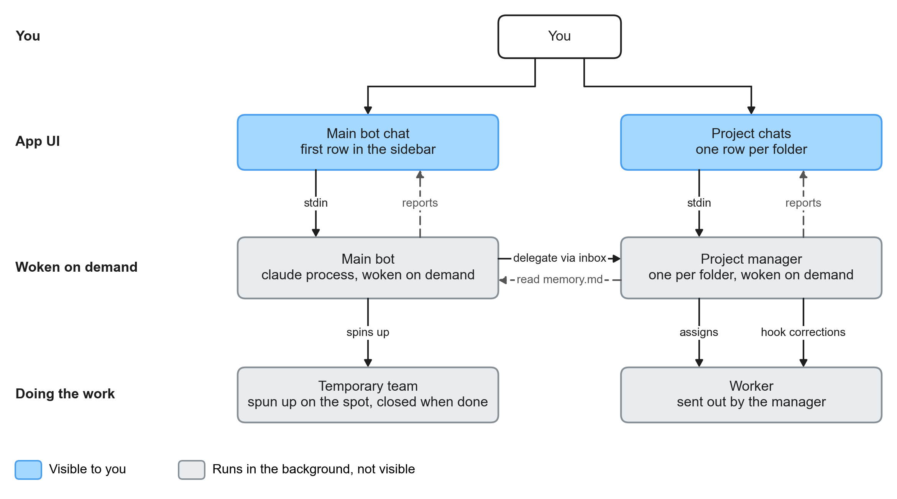
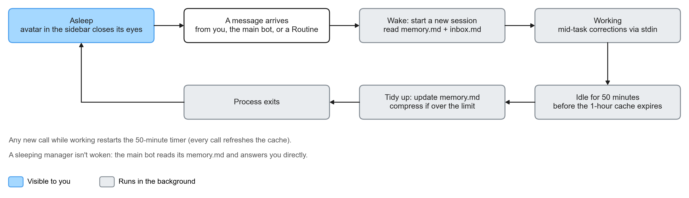
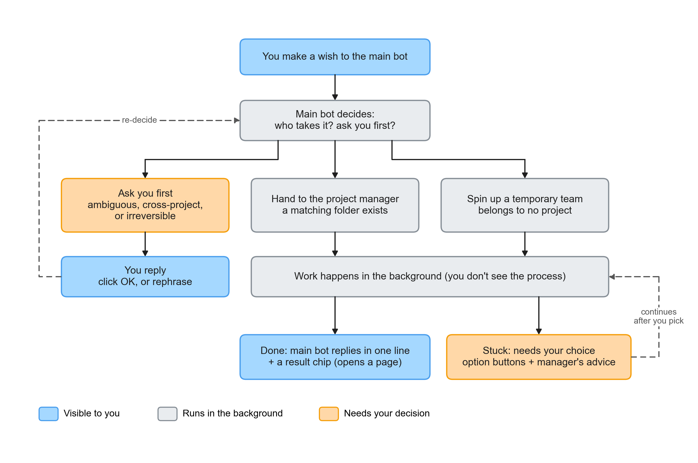
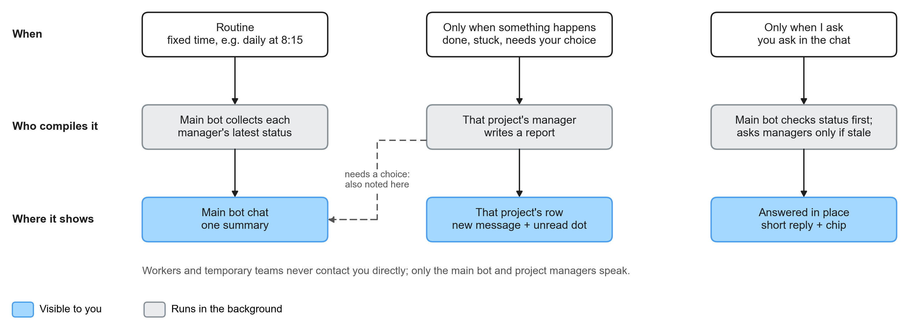

# PRD: ClaudeCodeBot, a command center for Claude Code

> Version: v0 draft · 2026-10-19 · Purpose: make sure we are aligned; this is not a spec
> Technical basis: internal notes on Claude Code's multi-agent collaboration mechanisms and the results of a steering-probe prototype (not included in this repository)

## 1. In one sentence

A local app that looks like Grok Bot. You only chat: make wishes, ask for progress, confirm direction. The work gets done in the background by each project's manager and by temporary teams. Managers are woken only when needed; when idle, they tidy their notes and go to sleep.

## 2. Problems to solve

- You run many Claude Code sessions on your machine at once, and your attention gets fragmented.
- You don't know who is doing what, who is stuck, or who is waiting on you.
- Even for a small task, you have to open a session yourself, switch folders, and watch it until it finishes.

**What success looks like**: you open just this one window each day and know the state of every project. After making a wish you don't have to watch it; you are only called when you are really needed.

## 3. Scope

| In | Out |
|---|---|
| Main bot: ask for progress, make wishes, receive summaries | A terminal |
| Each project folder is one row on the left; its manager reports there | File browsing, code diffs |
| Replies are short text plus clickable chips; a chip opens a result page (artifact) | Showing workers, tool calls, logs |
| Buttons appear only when you need to choose | Managing temporary teams in the UI |
| Three reporting modes: Routine, only when something happens, only when I ask | Multi-user collaboration, cloud, mobile |
| Switch between Haiku / Sonnet / Opus in the right column's settings subpage (hands off, then restarts) | Switching models mid-conversation |
| Built-in components: each component has a feedback button beside it; state a request and it gets changed directly | Treating the component library as a project row on the left |
| | The previous version's "big-picture Docs" and CLAUDE.md review flow |

## 4. Screen: three columns, at most 3–4 important things per page

**Principle**: people have very little attention, so each page shows only the 3–4 most important things. Anything less important goes into a subpage, or shrinks to a dot or a color. The less text the better; let the screen speak for itself.

| Column | What goes in | What stays out |
|---|---|---|
| **Left: who** | The main bot plus one row per project: avatar and name. Status is just a dot: orange means waiting on you, blue means new messages. A sleeping bot's avatar closes its eyes. While a component is being revised, a temporary "Components" row appears | Preview text, the word "asleep", search |
| **Middle: conversation** | The conversation plus an input box. Replies are short sentences and chips; option buttons appear only when you need to decide | Title bar, model, status text |
| **Right: now + results** | For the main bot, the right column shows "Waiting on you" and "Just finished"; for a project, it shows "Now" and "Results". Results are real visuals, such as app screenshots or web page previews | Settings items |
| **Right subpage: settings** | Opened via the icon at the top right of the right column: model (changing it hands off and restarts), Routines, folder path | — |

- **Viewing a result**: clicking a result expands the right column into a large preview and narrows the conversation; closing it restores the layout.
- **Component feedback**: the feedback button appears beside a component only when you hover over it.

**What matters on each page:**

| Page | The 3–4 most important things |
|---|---|
| Main bot | Status dots in the left column, conversation, waiting on you, just finished |
| You need to choose | Question and options, now (waiting for your choice), results |
| Project chat | Conversation (you can correct mid-task), now (what it's doing and progress), results |
| Viewing a result | Large result view, conversation (just say what to change) |
| Settings subpage | Model, Routines |

## 5. Roles

| Role | What it is | Visible to you? |
|---|---|---|
| You | CEO: make wishes, ask for progress, make decisions | — |
| Main bot | A claude process woken only when needed. Reads each project's memory.md to know the state, and dispatches wishes | ✅ First row on the left |
| Project manager | One per folder, woken only when needed. Manages that project's workers and reports upward | ✅ That project's row (eyes closed when asleep) |
| Worker | Sent out by a manager to do the work | ❌ |
| Temporary team | Spun up by the main bot for a one-off wish, closed when done | ❌ |
| Component team | Built into the app. Maintains the components used in conversations, such as multiple choice, progress, preview frames | Appears on the left only during a revision |



### 5.0 Components: built into the app, with feedback right beside them

- The interactive elements in a conversation are all **components**, such as multiple choice, progress, and result preview frames. They are part of the app itself, not a project.
- Every component has a **feedback button** beside it. Click it and type how it should change, for example "lay the options out horizontally"; once sent, the component team changes it directly. The updated component is swapped in place and marked "Updated".
- The main bot and managers can also **@component**, for example "error messages need a new component".
- Normally the component team is invisible. Only during a revision does a "Components · in progress" row appear on the left; it disappears when done.
- Implementation:
  - The conversation itself is SwiftUI; only components are drawn in an embedded web view (WKWebView), and scroll events are handed back to the conversation.
  - Each component is a `template.html` in `~/.claudecodebot/components/<name>/`, plus an `about.md` describing its data format. "Multiple choice" (choices) is built in.
  - The component team uses Haiku to edit templates. Before each change, the app saves the old version as `template.prev.html`, and the feedback box offers "Revert to previous version". The app checks the files every 1.5 seconds and hot-reloads when a change lands.
  - A component has only one way to answer: `ccb.answer(number)` picks an option by index, and `ccb.answer(text)` is a free-form answer. The app treats both as answered, so a request like "add an 'Other' option" can be done by the component team by editing the template alone, without touching the app.
  - Every bot, when woken, receives the full `about.md` of every component (what it is, its data format, what comes back when it's answered). When a component's usage changes, awake bots receive the update before their next message.
  - Bots don't write HTML: multiple choice uses a `<choices>` block; other components are shown with `<show name="component">JSON</show>`; a revision or a new component is requested with `<component name="component">request</component>`.

### 5.0.1 Switching models: hand off → stop → restart

The model is switched only in the right column's settings subpage, never mid-conversation. Switching does three things in order:

1. **Write a handoff**: ask the current process to write what it has in hand into `memory.md`, the same way it tidies up before sleeping.
2. **Stop**: end the current process.
3. **Restart**: open a new session with the new model and have it read `memory.md` to continue.

The conversation shows only a single divider: "Handoff → Opus".

### 5.1 Memory and schedule: woken when needed, tidies up and sleeps after 50 idle minutes

Neither the main bot nor the managers stay resident. Their memory doesn't live in the session; it lives in md files:

```
<project>/.bot/            # added to .gitignore
├── memory.md              # this manager's entire memory, max 150 lines
└── inbox.md               # tasks handed to it while asleep; read and cleared on wake
~/.claudecodebot/main/     # the main bot's own folder, same structure
```

`memory.md` always has four sections. The main bot only needs to read the first one to answer "how is X going?":

1. **Current status**: three sentences or fewer.
2. **In progress**.
3. **Waiting on your decision**.
4. **Decisions made**: dated; compressed into a summary once over the limit.

Schedule:

- **Wake**: when a message arrives, the app opens a new session. The source can be you, the main bot, or a Routine. The new session first reads `memory.md` and `inbox.md`.
- **Working**: your mid-task corrections are sent in through stdin. Every call refreshes the cache.
- **After 50 idle minutes**, i.e. before the 1-hour cache expires, the app sends "tidy up". The bot writes what happened back into `memory.md`, compressing if it's over the limit. This tidy-up still hits the cache, so it's cheap. When it's done, the process exits and the avatar in the left column closes its eyes.
- **Someone asks for progress while it's asleep**: no need to wake it; the main bot reads its `memory.md` directly.
- **Someone hands it a task while it's asleep**: the task is written into its `inbox.md`, then it is woken.

**Why open a new session on wake instead of `--resume`**: after 50+ minutes of sleep, the cache has long expired. `--resume` would pay again for the entire old conversation, and that conversation keeps growing. A new session reads only a `memory.md` of at most 150 lines, so the cost is fixed. Old session ids are kept so you can dig through them if needed.



## 6. Wish flow

You said "let it decide for itself", so the main bot decides on its own whether to ask you first. The decision rules live in the main bot's system prompt, not in the UI:

- **Just do it**: the scope is clear and it can be undone. For example, adding a UI element, changing copy, fixing one bug.
- **Ask you one question first** when:
  - there are two or more reasonable interpretations;
  - it touches multiple projects;
  - it changes rules (CLAUDE.md, settings);
  - it is irreversible, such as push, deploy, delete;
  - it is expected to take long or cost a lot, such as running Opus for a long time.
- **Who takes it**:
  - If there is a matching project folder, it goes to that project's manager.
  - If there is no matching folder, a temporary team is spun up. A team is a markdown definition in `~/.claudecodebot/teams/<name>.md` that specifies roles, models, and available tools; you can edit it directly. "Research team" (research) and "Prototype team" (prototype) are built in.
  - The main bot appends `<team name="name">task</team>` to its reply, and the app spins up the team in `~/.claudecodebot/runs/<timestamp>-<name>/`. When the team finishes, it replies with one sentence plus a result page; the report appears in the main bot's conversation and the team ends. The "Now" section in the main bot's right column lists teams still working.



## 7. Reporting rules

| When | Who compiles it | Where it appears |
|---|---|---|
| Routine, e.g. daily at 8:15 | The main bot collects each manager's status | One summary in the main bot's conversation |
| Only when something happens: done, stuck, needs your choice | That project's manager | That project's row, plus an unread dot. When you need to choose, the main bot also mentions it |
| Only when I ask | The main bot first reads the "Current status" in each manager's `memory.md`; it wakes the manager only if that isn't enough | Answered in place |

Noise rules:
- Workers and temporary teams never contact you directly.
- Each reply is at most 3–5 sentences; details go into the result page.



## 8. Technical approach (all tested, n=1)

| Need | Approach |
|---|---|
| Wake | `claude -p --input-format stream-json --output-format stream-json --verbose --session-id <new id>`. While awake, stdin stays open |
| Sleep | The app records the time of the last stream event; after 50 idle minutes it sends "tidy up", waits for the reply to finish, then closes stdin to end the process |
| Your messages and mid-task corrections | Written to that process's stdin. A message sent during a run is merged into the current turn |
| Main bot → manager | Manager asleep: write into its `inbox.md`, then wake it. Manager awake: send to `/tmp/cc-socks/<pid>.sock` |
| Manager → worker (mid-task corrections) | Socket, or a `PostToolBatch` hook that reads the inbox, injects it once, then clears it |
| Reporting to the app | Tags in the reply, which the app parses and strips: `<choices>` is drawn as buttons, `<team>` spins up a team, `<component>` goes to the component team, `<show>` renders a component. We originally planned to use MCP tools; we switched to tags because that avoids running an extra server, and claude follows them reliably |
| Result pages | A single HTML page: the main bot saves to `~/.claudecodebot/main/artifacts/`, managers save to `<project>/.bot/artifacts/`, teams save to their own `runs/` folder. Clicking a chip expands a preview in the right column |
| Manager's tools | Read, Write, Edit, Glob, Grep, Bash, used only inside its own project folder, in `acceptEdits` mode. The main bot has only Read, Write, Edit, and can reach only its own folder and each project's `.bot/` |
| Routine | Each bot has a crontab-style `routines.cron` (main bot in `~/.claudecodebot/main/`, managers in `.bot/`), one job per line: `min hour day month weekday name: what to do`, where "what to do" is a one-line prompt or `@file`, and a leading `#` pauses the job. Bots can edit it themselves, and the settings subpage edits the same file. The app checks the clock every 30 seconds and, when a job is due, sends one line to stdin; the app records when each job last ran |
| App restart | Nothing special needed: all memory is in `memory.md` and is read as usual on the next wake |
| UI | Standalone SwiftUI app (`ClaudeCodeBot/`); locating claude and `LineBuffer` are reused from NotchDo |
| Waiting count | The number on the Dock icon = items still waiting on your decision |

**Not yet tested**:
- Whether external messages are held while a worker runs in bypass mode;
- Limits when many messages arrive in a row;
- Interrupts.
- Whether the tidy-up at 50 minutes really hits the cache (check `cache_read_input_tokens`).
- Whether 150 lines of `memory.md` is enough.

## 9. Milestones

| # | Content | Acceptance |
|---|---|---|
| M1 | Just the main bot row: chat, model switching (hand off then restart), chip rendering, plus the schedule (wake, tidy up at 50 minutes, eyes closed while asleep) | After chatting, leave it for 50 minutes: `memory.md` is updated and the avatar closes its eyes; ask one more question and it remembers what was just discussed |
| M2 | Project rows: picking a folder creates a manager; the main bot reads the manager's `memory.md`, or delegates by writing to its inbox | With the manager asleep, asking the main bot "how is NotchDo going?" gets a correct answer without waking it |
| M3 | Only when something happens: option buttons, unread dots, reminders in the main bot's conversation | When a manager is stuck, you click an option in its row and it continues |
| M4 | Routine: toggles plus timing in the settings subpage | A summary arrives every day at 8:15 |
| M5 | Wishes plus temporary teams: team definition files, spin-up and teardown | Make a wish that belongs to no project, don't intervene, and end up with a result chip |
| M6 | Components: template + schema, feedback button beside it, @component, hot reload | Report "make it horizontal" beside a multiple-choice component and see the new version without restarting the app |

### Implementation status (2026-10-19)

M1–M6 are all done. Each was accepted by running real claude (Haiku), plus 55 unit tests. What the real-claude acceptance runs covered:

| # | Real-claude acceptance |
|---|---|
| M1 | Remember "teal" → tidies up and sleeps on its own after 15 seconds → still remembers after waking |
| M2 | Asked for progress while the manager was asleep: correct answer, manager not woken; after delegating, the manager actually created the README |
| M3 | The manager asked via buttons "Garden or Plant Diary?"; the choice was made in the main bot's conversation and the manager wrote it accordingly |
| M4 | The 08:15 daily summary listed what managers were waiting on you for, without waking them |
| M5 | A wish belonging to no project: the main bot spun up a team on its own and delivered an HTML page |
| M6 | Reported "set button height to 56px"; the component team updated the template and the app detected the new version |

Differences from the original plan:
- Managers are not resident: woken only when needed; after 50 idle minutes they tidy up and sleep.
- Reporting uses tags in replies instead of MCP tools.
- The conversation uses SwiftUI; only components are drawn as web views.
- Sleep is shown by "closed eyes", not by dimming the whole row.

## 10. Open questions for you

1. ~~What goes in the right panel~~: decided. The right column shows "now + results"; settings go into a subpage.
2. **Should we build the group avatars at the top?** Grok has groups like Ai posts and Finance. For v0 the recommendation is no.
3. **Standalone app, or inside NotchDo?** Recommendation: a standalone app. NotchDo's notch only shows "N waiting on you".
4. ~~What if a component change breaks it~~: implemented. Every revision keeps the previous version, and the feedback box offers "Revert to previous version".
5. ~~Can managers use Bash~~: decided (2026-10-19), keep the current approach. Managers can run Bash directly inside their own project folder without asking you first.
