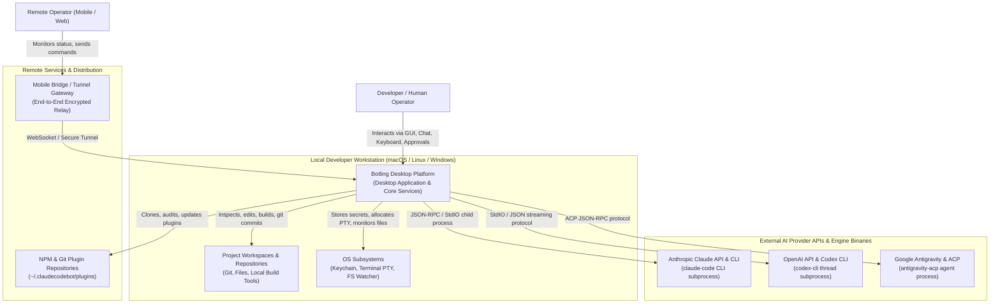
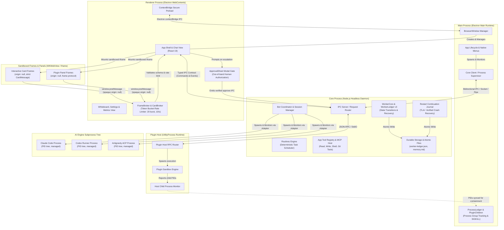

# Architecture Specification: System Overview & C4 Models

## 1. Document Context & Purpose

This document specifies the system-level architecture of **Botling 2.0+**, an extensible desktop AI collaboration platform. Botling orchestrates multiple autonomous AI engine runtimes (Anthropic Claude Code CLI, OpenAI Codex CLI, Google Antigravity ACP) within a resilient multi-process desktop application.

This specification follows the **C4 Model** (Context, Containers, Components, Code):
- **C4 Level 1 (System Context)** establishes Botling's external interfaces, actors, cloud APIs, and local operating system boundaries.
- **C4 Level 2 (Container / Process Boundaries)** delineates process boundaries, IPC transport channels, privilege separation, and sandboxing mechanisms across the application.

---

## 2. C4 Level 1: System Context

The System Context diagram illustrates how Botling integrates with the developer's local environment, external AI reasoning providers, and companion endpoints.

### 2.1 System Context Diagram

### 2.2 External Actors and Interfaces

| Entity | Role & Relationship | Interface & Protocols |
|---|---|---|
| **Human Operator** | Primary user directing multi-agent tasks, reviewing code changes, and approving tool/permission escalations. | Desktop GUI (Electron/React), Whiteboard, Keyboard shortcuts, System Menus. |
| **Project Workspaces** | Target source trees modified by coordinated bots and subagents. | Direct POSIX filesystem I/O, atomic file operations (`writeFileAtomic`), Git CLI operations. |
| **OS Subsystems** | Operating system services for security, process isolation, and command execution. | macOS Keychain / OS Credential Store, POSIX process groups / Windows Job Objects, PTY streams (`node-pty`). |
| **Claude Code Engine** | Anthropic's agentic CLI child process. | StdIO streaming with custom delimiters, JSON-RPC streaming, session resumption flags. |
| **Codex CLI Engine** | OpenAI agent runner managing persistent thread sessions. | StdIO streaming, thread resume arguments, managed subagent coordination. |
| **Antigravity ACP Engine** | Google Antigravity Agent Control Protocol (ACP) process. | JSON-RPC over StdIO/sockets, capability negotiation, strict single-action approval tokens. |
| **Plugin Repositories** | Versioned extension packages extending UI cards, custom commands, and MCP tools. | Git clone/pull, npm package downloads, semantic version resolution. |
| **Mobile Bridge Gateway** | Optional companion relay enabling out-of-band monitoring and remote intervention. | TLS WebSocket, token-authenticated mobile bridge protocol. |

---

## 3. C4 Level 2: Container / Process Boundaries

Botling decomposes into four core container runtimes, plus isolated child process trees for AI engines and plugin tasks. This architecture guarantees that untrusted web content or failing third-party plugins cannot crash the core agent coordination engine or compromise host security.

### 3.1 Container Architecture Diagram

---

## 4. Container Catalog & Boundary Characteristics

### 4.1 Electron Main Process (`desktop/src/main/`)
- **Technology**: Electron Main (Node.js runtime, native macOS/Linux/Windows bindings).
- **Responsibilities**:
  - Bootstrapping the runtime, configuring security fuses, and instantiating application windows.
  - Process lifecycle orchestration: starting, health-monitoring, and terminating the headless Core process.
  - Process containment (`PluginChildren` & `ProcessLedger`): tracks all child process groups across plugin hosts and AI engines; guarantees zero orphan processes on quit or crash via `SIGTERM` followed by a hard `SIGKILL` after grace period.
  - Native window menus, update verification, and window screenshotting / preview capture.
- **Trust Level**: Privileged / Root of Trust. Holds direct OS privileges.

### 4.2 Core Server Process (`desktop/src/core/`)
- **Technology**: Headless Node.js process (isolated from renderer UI dependencies).
- **Responsibilities**:
  - The single source of truth for agent coordination, session history, and task dispatch.
  - **WorkerCore & WorkerLedger**: Maintains `worker-ledger.json` (v3 schema), orchestrating subagent lifecycles, run counters, and report delivery states.
  - **Restart Continuation Journal**: Persists in-flight tasks across app restarts, executing TLA+-verified crash recovery protocols (`Restart.tla`).
  - **Bot Coordination**: Manages bot heads (`ClaudeHead`, `CodexHead`, `AgyAcpHead`), handling message queuing, turns, and the idle tidy cycle.
  - **MCP Tool Registry**: Provides controlled file reading, atomic writing, shell execution, and git operations with deterministic permission enforcement.
  - **Routines Engine**: Schedules periodic and background maintenance tasks.
- **Trust Level**: High. Performs filesystem writes, spawns engine processes, and mediates permission grants.

### 4.3 Renderer Process (`desktop/src/renderer/`)
- **Technology**: Electron Renderer, React 19, TypeScript, CSS modules.
- **Responsibilities**:
  - Rendering conversational UI, stream tokens, diffs, Whiteboard lanes, and settings panels.
  - **Preload Bridge (`desktop/src/preload/`)**: Uses Electron's `contextBridge` to expose strictly typed, bidirectional contract methods (`postCommand`, `subscribeEvents`) without exposing raw Node or Electron APIs.
  - **FrameBroker & CardBroker**: Manages sandboxed embedded components. Enforces opaque origin (`null`), token-bucket rate limiting (20 burst, 10 calls/sec), and strict schema parsing.
  - **ApprovalSheet**: Modal gate rendered strictly outside sandboxed frames to capture human confirmation for high-risk actions.
- **Trust Level**: Medium. Web environment running UI components; protected against direct OS access via preload isolation.

### 4.4 Plugin Host Process (`desktop/src/host/`)
- **Technology**: Electron `UtilityProcess` / Node.js child process.
- **Responsibilities**:
  - Runs untrusted or user-supplied plugin scripts (e.g. data extractors, custom commands, panel logic).
  - Isolated from the Main process and Core server memory space.
  - Communicates exclusively over a narrow JSON-RPC channel with the Core server.
  - All subprocesses spawned by the plugin host are monitored and reported to Main for deterministic cleanup.
- **Trust Level**: Low / Untrusted. Restricted capability envelope; network and filesystem access gated by explicit declarations.

### 4.5 Sandboxed Frames (Cards & Panels)
- **Technology**: Isolated `<iframe>` elements configured with `sandbox="allow-scripts"`.
- **Responsibilities**:
  - Renders third-party generated UI, interactive charts, and rich card payloads.
  - Origin is strictly opaque (`origin === "null"`).
  - Communicates outward solely via `window.postMessage`. Any attempt to trigger privileged actions returns `needsApproval`, requiring the outer `ApprovalSheet` to confirm.
- **Trust Level**: Zero (Untrusted). Completely isolated from local DOM and node APIs.

---

## 5. Inter-Process Communication (IPC) Matrix

| Path | Mechanism | Serialization | Authentication / Security Guard |
|---|---|---|---|
| **Main <-> Core** | StdIO Streams / Domain Socket | Line-delimited JSON / JSON-RPC | Supervised process boundary; parent-child PID verification. |
| **Renderer <-> Core** | ContextBridge IPC via Main | Typed Contract Commands & Events | Preload whitelist; argument validation via Zod schemas. |
| **Renderer <-> Sandboxed Frames** | HTML5 `window.postMessage` | JSON (`CardMessage` / `FrameProtocol`) | Opaque origin check (`origin === "null"`), source window equality, token bucket rate limiter. |
| **Core <-> Plugin Host** | IPC Channel (`utilityProcess.postMessage`) | Structured JSON-RPC | Capability handshake, command ownership validation (`ownsCommand`). |
| **Core <-> AI Engines** | StdIO Pipes (`stdin`/`stdout`/`stderr`) | Stream delimiters / JSON-RPC (ACP) | Strict PID capture, process start time verification against PID recycling. |

---

## 6. Architectural Principles & Invariants

1. **Crash Resilience & Independent Lifecycles**: A crash in a plugin host, an AI engine process, or the Renderer process never corrupts the Core server or destroys persistent state.
2. **Deterministic Process Containment**: Every spawned child process belongs to a tracked process group registered in the `ProcessLedger`. Orphan processes are prevented across crashes and hard shutdowns.
3. **Single Source of State Truth**: `WorkerLedger` v3 (`worker-ledger.json`) is the definitive ledger for worker states, runs, and report delivery. UI states are purely stateless projections.
4. **Out-of-Band Security Approvals**: Sandboxed cards and untrusted plugins can never approve their own privilege escalations; approvals must traverse the secure `ApprovalSheet` modal gate.

> **Plugin architecture & creator mode**: how the core is slimmed into first-party plugins with revocable registrations (without adopting the Cordis IoC framework) is recorded in [ADR-005](adr/005-plugin-architecture-and-core-slimming.md); the mechanisms borrowed from DeepSeek Harness creator mode (progressive skills, read-only introspection, `nextStep` repair guidance, suggestion cards) are in [ADR-006](adr/006-creator-mode-borrowed-mechanisms.md).
