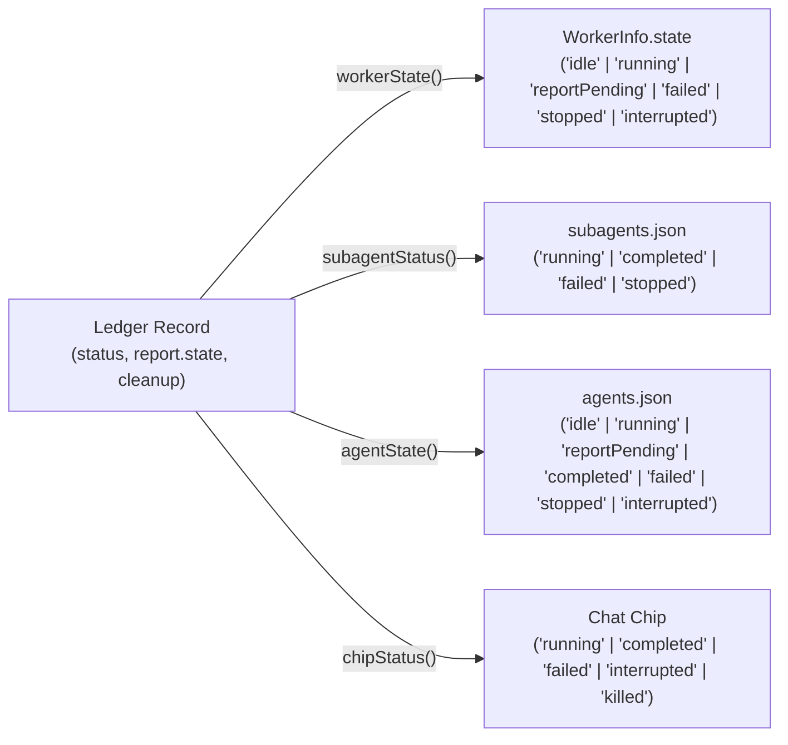
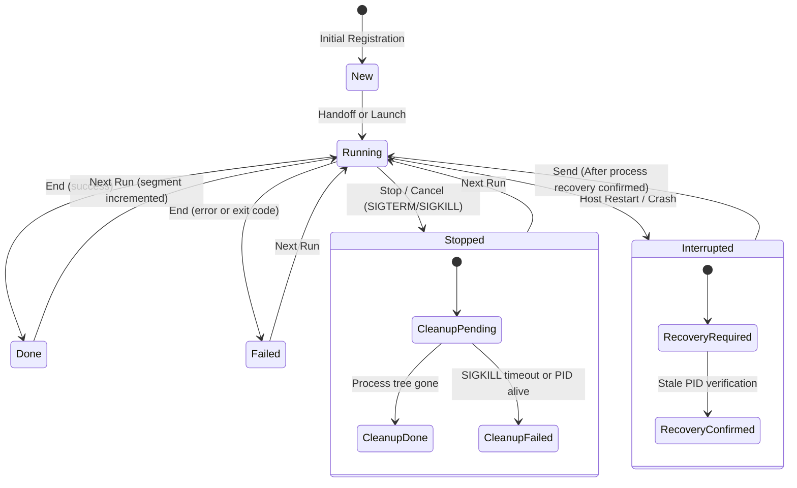
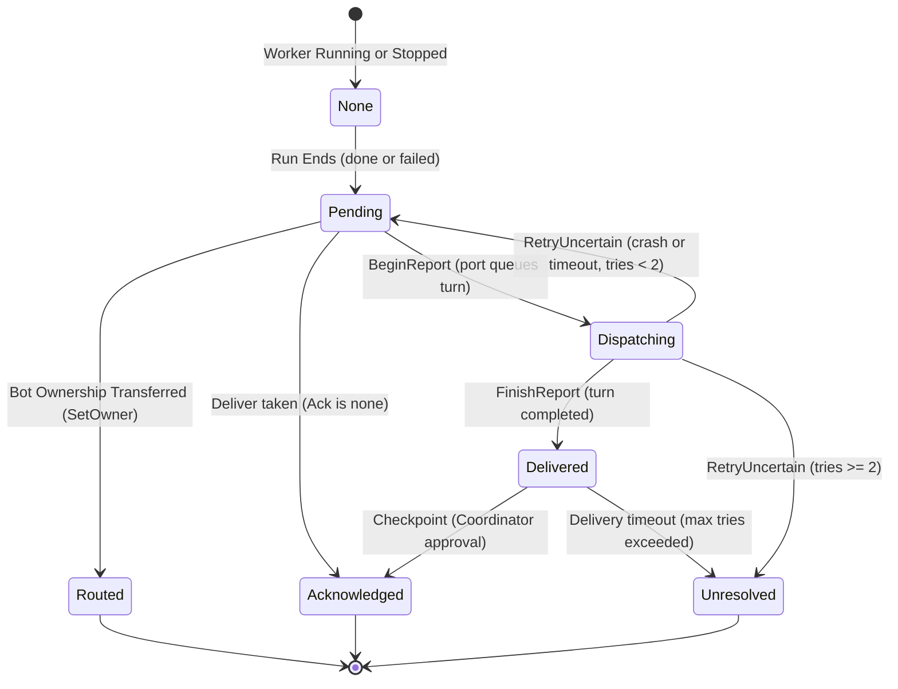

# Architecture Specification: Data Models, State Machines & Formal Verification

## 1. Document Context & Purpose

This specification defines the core data contracts, state machines, invariants, and formal verification models of **Botling**. Specifically, it covers:
1. **`WorkerLedgerRecord` v3**: The canonical durable record for all background and delegated AI worker tasks.
2. **Bot Session & File-First Memory Data Models**: `BotSessionState`, `SessionWarmCacheEntry`, and markdown `.bot/memory.md` storage.
3. **State Projections**: The deterministic mapping functions from core ledger state to UI and subsystem views.
4. **State Machine Specifications**:
   - Bot Session & Warm Cache Lifecycle (`stateDiagram-v2`).
   - Worker Lifecycle State Machine (`stateDiagram-v2`).
   - Worker Report Delivery State Machine (`stateDiagram-v2`).
5. **Formal Verification Models (TLA+)**:
   - `specs/tla/BotSessionLifecycle.tla`: Cache consistency, memory bounds, single-writer locks, and zero data loss during cache eviction.
   - `spec/models/worker/Worker.tla`: Concurrency, lifecycle, cancellation, and report handoff invariants.
   - `spec/models/restart/Restart.tla`: Crash resilience, shutdown continuation journaling, and at-most-once recovery semantics.

---

## 2. Bot Session & Memory Data Models

### 2.1 File-First Memory Schema (`.bot/memory.md`)

Botling stores high-level context in a human-readable, git-tracked markdown file (`.bot/memory.md`). It adheres to four canonical headings and a strict line-budget invariant:

```markdown
# Current status
Concise snapshot of current system or project status.

# In progress
Active tasks, pending refactors, or background worker jobs.

# Waiting on you
Human input blockers, pending code reviews, or approval gates.

# Decided
Architectural and design decisions recorded during sessions.
```

#### Memory Invariants
- **Line Limit Invariant**: `.bot/memory.md` must remain strictly under 150 lines. Idle tidy routines consolidate notes when line budgets approach capacity.
- **Section Headers**: All four headings must be preserved during automated and human edits.
- **Atomic Modification**: Writes to `.bot/memory.md` use atomic file replacement (`writeFileAtomic`) to prevent half-written files on crash.

### 2.2 Bot Session State & Warm Cache Data Structures

```typescript
export type SessionState = "closed" | "idle" | "busy" | "waiting_approval" | "checkpointing";
export type CacheStatus = "cold" | "warming" | "warm" | "evicting";

export interface BotSessionState {
  sessionId: string;                            // Unique session UUID
  botId: string;                                // Bot configuration identifier
  workspacePath: string;                        // Root workspace folder path
  dataFolderPath: string;                       // Path to .bot/ directory
  engine: "claude" | "codex" | "agy";          // Active engine runtime
  state: SessionState;                          // Live session execution state
  turnIndex: number;                            // Current turn sequence number
  activeTurnId: string | null;                  // UUID of turn currently in flight
  lastActiveEpoch: number;                      // Timestamp of last interaction
  lockToken: string | null;                     // Acquired core.lock token
  warmCache: SessionWarmCacheEntry;             // Memory-resident cache descriptor
}

export interface SessionWarmCacheEntry {
  status: CacheStatus;                          // Cache residency state
  memVersion: number;                           // In-memory memory.md version counter
  diskMemVersion: number;                       // Persisted memory.md version counter
  cacheDirty: boolean;                          // In-memory memory notes modified
  residentHistoryTokens: number;                // Primed context token size
  headHandle: unknown | null;                   // Live engine coordinator handle
  warmedAt: number | null;                      // Epoch timestamp when warm status reached
  lastAccessEpoch: number;                      // LRU timestamp for cache eviction
}
```

---

## 3. Canonical Worker Data Model: `WorkerLedgerRecord` v3

Worker state in Botling is unified under a single source of truth: `<member store>/worker-ledger.json` (`desktop/src/core/worker-core/ledger.ts`). It is written exclusively by `WorkerCore` at state transition boundaries (launch, end, report settlement, owner change, crash recovery) using atomic file writes (`writeFileAtomic`).

```typescript
export interface WorkerLedgerRecord {
  v: 3;
  id: string;                                   // Task UUID
  engine: "claude" | "codex" | "agy";          // Engine runtime
  adapter: "claude-process" | "codex-thread" | "agy-acp" | "component-editor";
  name: string;                                 // Worker label
  instructions: string;                         // Initial prompt instructions
  type: string | null;                          // Subagent classification type
  ownerSessionId: string;                       // Coordinator session ID
  run: number;                                  // Monotonically increasing run count
  segment?: number;                             // Post-restart run segment counter
  status: WorkerStatus;                         // Core status
  report: WorkerReportRecord;                   // Delivery & checkpoint status
  conversationId: string | null;                // Engine-level session/thread handle
  processes: ProcessIdentity[];                 // Tracked PIDs (max 8, sorted oldest to newest)
  owner?: WorkerOwner;                          // Associated owner metadata
  createdAt: number;                            // Creation epoch timestamp
  runStartedAt: number | null;                  // Active run start timestamp
  endedAt: number | null;                       // Termination timestamp
  interruptedBy?: "quit" | "restart" | "crash"; // Reason for interruption
  recovery?: "required";                        // Indicates orphaned process verification needed
  cleanup?: "pending" | "failed";               // Asynchronous process tree cleanup status
  engineData: Record<string, unknown>;          // Engine-private opaque state
}

export interface WorkerReportRecord {
  state: ReportState;                           // Report delivery state
  text: string | null;                          // Final report prose
  status: RunStatus | null;                     // Terminal run outcome
  attempts: number;                             // Delivery attempts to coordinator
  checkpoint?: ReportCheckpoint;                // Checkpoint outcome & evidence
}

export interface ReportCheckpoint {
  outcome: string;                              // Outcome disposition (e.g. accepted, rejected)
  evidence: string;                             // Supporting evidence string
  dependencyTaskId?: string;                    // Associated dependency task ID
}
```

---

## 4. Worker State Vocabulary & Status Projections

The tuple `(status, report.state, cleanup)` uniquely defines the worker state. All external views (`WorkerInfo.state`, `subagents.json`, `agents.json`, and the chat chip) are pure projections (`desktop/src/core/worker-core/status.ts`).

### 4.1 Vocabulary Definitions

| Type | Allowed Values | Semantic Meaning |
|---|---|---|
| `WorkerStatus` | `new` | Initialized record; has never launched a process. |
| | `running` | Child process or engine thread is actively executing. |
| | `done` | Engine exited successfully with a completed result. |
| | `failed` | Engine exited with an error, exception, or non-zero code. |
| | `stopped` | Explicitly aborted by user or coordinator stop command. |
| | `interrupted` | Abnormally terminated by host restart, crash, or SIGKILL. |
| `ReportState` | `none` | No report is owed (while running, stopped, or new). |
| | `pending` | Run ended; report is waiting for coordinator pickup. |
| | `dispatching` | Report is being transferred (e.g. Antigravity `beginReport`). |
| | `delivered` | Coordinator received report; awaiting checkpoint decision. |
| | `acknowledged` | Fully settled (policy `none` at delivery; policy `checkpoint` after review). |
| | `unresolved` | Coordinator exceeded max delivery attempts without deciding. |
| | `routed` | Ownership transferred to another bot; report emitted for routing. |

### 4.2 Projection Matrix



#### Exact Projection Formulas
- **`showsFailed(r)`**:
  $$\text{cleanup} = \text{"failed"} \lor (\text{report.state} = \text{"unresolved"} \land \text{status} \in \{\text{"done"}, \text{"failed"}\})$$
- **`reportOwed(state)`**:
  $$\text{state} \in \{\text{"pending"}, \text{"dispatching"}, \text{"delivered"}\}$$
- **Chat Chip (`chipStatus`)**:
  1. If `showsFailed(r)` $\to$ `failed`
  2. If `status == "running"` $\to$ `running`
  3. If `status == "done"` $\to$ `completed`
  4. If `status == "failed"` $\to$ `failed`
  5. If `status == "interrupted"` $\to$ `interrupted`
  6. Otherwise (`stopped`, `new`) $\to$ `killed`

---

## 5. State Machine Specifications

### 5.1 Bot Session & Warm Cache Lifecycle State Machine

The Bot Session lifecycle governs cache priming, interactive turn processing, human approval pauses, checkpointing, and cache eviction under memory pressure.

```mermaid
stateDiagram-v2
    [*] --> Closed: Initial State

    Closed --> Warming: Open Workspace (Acquire core.lock)
    Warming --> Warm_Idle: Warm Cache Primed (.bot/memory.md loaded)

    Warm_Idle --> Busy_Executing: User Prompt or Routine Trigger
    Busy_Executing --> WaitingApproval: Gated Action (ApprovalSheet Prompt)
    WaitingApproval --> Busy_Executing: Operator Grants Permission
    WaitingApproval --> Warm_Idle: Operator Rejects Action

    Busy_Executing --> Checkpointing: Turn Finished (Dirty notes generated)
    Checkpointing --> Warm_Idle: Checkpoint Committed (Atomic disk flush)

    Warm_Idle --> Evicting: Memory Pressure or Idle Sleep Timeout
    Evicting --> Closed: Cache Flushed & Lock Released

    Closed --> [*]
```



### 5.2 Worker Lifecycle State Machine



### 5.3 Worker Report Delivery State Machine

The report delivery lifecycle manages handover from the worker to the coordinator conversation. Delivery adheres to one of two policies:
- **`Ack = "none"` (Claude)**: Immediate acknowledgment upon single delivery.
- **`Ack = "checkpoint"` (Codex, Antigravity)**: Coordinator must review evidence and emit an explicit checkpoint (`app_task_checkpoint`) within at most 2 delivery attempts.



---

## 6. Formal Verification with TLA+

Botling's critical distributed concurrency protocols and cache lifecycle models are formally verified using TLA+ model checking (TLC).

### 6.1 Bot Session & Warm Cache Protocol (`BotSessionLifecycle.tla`)

- **Specification Location**: `specs/tla/BotSessionLifecycle.tla`
- **Config**: `specs/tla/BotSessionLifecycle.cfg`
- **Checker**: `spec/tools/tlc.sh specs/tla/BotSessionLifecycle.tla`
- **Real-world Component**: `desktop/src/core/session/`, `desktop/src/core/shared-core/`

#### Model State Variables
- `sessionState`: `[Sessions -> {"closed", "idle", "busy", "waiting_approval", "checkpointing"}]`
- `cacheStatus`: `[Sessions -> {"cold", "warming", "warm", "evicting"}]`
- `cacheDirty`: `[Sessions -> BOOLEAN]` (Tracks unpersisted memory modifications)
- `cacheMem`: `[Sessions -> Nat]` (In-memory memory.md version counter)
- `diskMem`: `[Sessions -> Nat]` (Persisted disk version counter)
- `diskLock`: `[Sessions -> BOOLEAN]` (Workspace `core.lock` ownership)
- `turnCount`: `[Sessions -> Nat]` (Bounded turn count)

#### Formally Verified Invariants

| Invariant Name | Mathematical Formula | Architectural Guarantee |
|---|---|---|
| **`SingleWriterIntegrity`** | $\forall s: (\text{cacheDirty}[s] \lor \text{sessionState}[s] \in \{\text{"busy"}, \dots\}) \implies \text{diskLock}[s]$ | Memory note updates and turn execution strictly require exclusive workspace lock ownership. |
| **`CacheConsistency`** | $\forall s: (\text{cacheStatus}[s] = \text{"warm"} \land \neg\text{cacheDirty}[s]) \implies (\text{cacheMem}[s] = \text{diskMem}[s])$ | Clean warm cache in memory always matches durable disk contents. |
| **`NoExecutionWhileCold`** | $\forall s: \text{sessionState}[s] \in \{\text{"busy"}, \text{"waiting_approval"}, \text{"checkpointing"}\} \implies \text{cacheStatus}[s] = \text{"warm"}$ | Execution cannot proceed while cache is cold, warming, or evicting. |
| **`NoDirtyDataLost`** | $\forall s: (\text{cacheStatus}[s] = \text{"cold"}) \implies (\neg\text{cacheDirty}[s] \land \text{sessionState}[s] = \text{"closed"})$ | Cache eviction flushes all dirty memory notes before transitioning to cold; zero data loss. |
| **`MemoryBudgetBound`** | $\text{WarmedCount} \le \text{MaxWarmSessions}$ | Resident warm cache sessions never exceed the configured memory budget. |

*TLC Model Check Results*: Complete state graph explored (541 generated states, 216 distinct states, search depth 27) with 0 errors.

---

### 6.2 Worker Lifecycle Protocol (`Worker.tla`)

- **Specification Location**: `spec/models/worker/Worker.tla`
- **Config**: `spec/models/worker/Worker.cfg`
- **Driver / Conformance Test**: `spec/driver/worker-driver.ts`, `spec/tests/worker.spec.test.ts`
- **Real-world Component**: `desktop/src/core/worker-core/core.ts`

#### Model State Variables
- `wk`: Function mapping each worker slot $x \in Workers$ to its record:
  - `status`, `run`, `rep`, `tries`, `queued`, `active`, `cleanup`, `recovery`, `stale`, `op`, `pend`, `owned`.
- `crashes`: Bounded counter ($0 \dots MaxCrash$) of host crash events.

#### Verified Safety Invariants

| Invariant Name | Mathematical Formula | Architectural Guarantee |
|---|---|---|
| **`OneLiveRun`** | $\forall x: wk[x].status = \text{"running"} \implies \neg wk[x].stale$ | No worker starts a new run while a previous process of that worker is still active. |
| **`StaleIsGuarded`**| $\forall x: wk[x].stale \implies (wk[x].recovery \lor wk[x].cleanup = \text{"pending"})$ | Any unconfirmed/stale process forces a cleanup barrier or recovery check before further execution. |
| **`OwedOnlyEnded`** | $\forall x: wk[x].rep \in \{\text{"pending"}, \text{"dispatching"}, \text{"delivered"}\} \implies wk[x].status \in \{\text{"done"}, \text{"failed"}\}$ | Reports are only generated and owed for terminated runs. |
| **`NoFalseFailed`** | $\forall x: wk[x].status = \text{"done"} \land Chip(wk[x]) \neq \text{"completed"} \implies (wk[x].cleanup = \text{"failed"} \lor wk[x].rep = \text{"unresolved"})$ | A successfully completed run never displays as failed in the UI unless its cleanup failed or report was unresolved. |
| **`OneTerminal`** | $[][\forall x: wk[x].status \in Ended \land wk'[x].run = wk[x].run \implies wk'[x].status = wk[x].status]_{vars}$ | A run's terminal status (`done`, `failed`, `stopped`, `interrupted`) is immutable for that run index. |
| **`NoStaleOp`** | Enforces that an asynchronous cancel/stop requested for run $R$ never cancels a subsequent run $R+1$. | Eliminates the critical race condition patched in commit `3910341f`. |
| **`ReportAtMostOnce`**| Enforces delivery limit ($tries < MaxShows$) and verifies reports are never presented after ownership handover. | Prevents duplicate report turns or cross-bot leakages. |

#### Verified Liveness Properties
- **`RunEnds`**: $\forall x: wk[x].status = \text{"running"} \leadsto wk[x].status \in Ended$ (Under weak fairness, any running worker eventually reaches a terminal state).
- **`ReportSettles`**: $\forall x: wk[x].rep = \text{"pending"} \leadsto wk[x].rep \in \{\text{"delivered"}, \text{"acknowledged"}, \text{"unresolved"}, \text{"routed"}, \text{"none"}\}$ (Every pending report eventually settles).

---

### 6.3 Restart Continuation Protocol (`Restart.tla`)

- **Specification Location**: `spec/models/restart/Restart.tla`
- **Config**: `spec/models/restart/Restart.cfg`
- **Driver / Conformance Test**: `spec/driver/restart-driver.ts`, `spec/tests/restart.spec.test.ts`
- **Real-world Component**: `desktop/src/core/restart-continuation.ts`, `Core.prepareRestart`

#### Verified Invariants in `Restart.tla`

1. **`AtMostOnce`**: $\forall b \in Bots: sent[b] \le 1$ (No bot continuation is ever delivered more than once across crashes).
2. **`OnlyRealWork`**: $\forall b \in Bots: sent[b] > 0 \implies (busy[b] \land \neg own[b] \land stop[b] = \text{"ok"})$ (Resumes only cleanly stopped active work).
3. **`ConfirmedOnly`**: $\forall b \in Bots: entry[b] \in \{\text{"claimed"}, \text{"dispatched"}\} \implies phase = \text{"ready"}$ (No continuation from incomplete journals).
4. **`OthersNeverBlock`**: $\forall b \in Bots: told[b] \neq \text{"none"} \implies Cause(b, told[b])$ (Participant failures are strictly partitioned).
5. **`BlockedIsTold`**: $\forall b \in Bots: entry[b] = \text{"blocked"} \implies told[b] \neq \text{"none"}$ (Held back tasks always communicate reasons).
