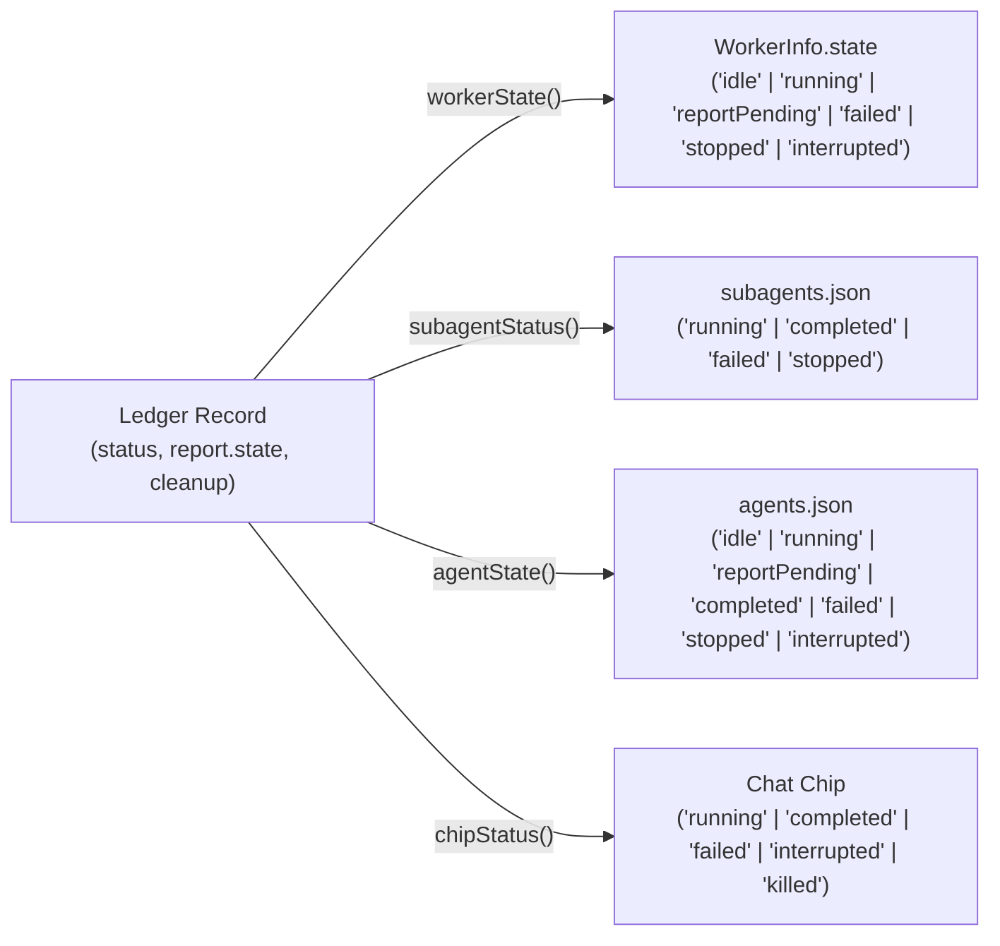
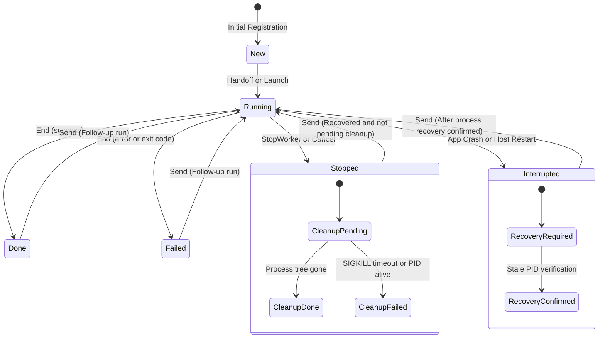
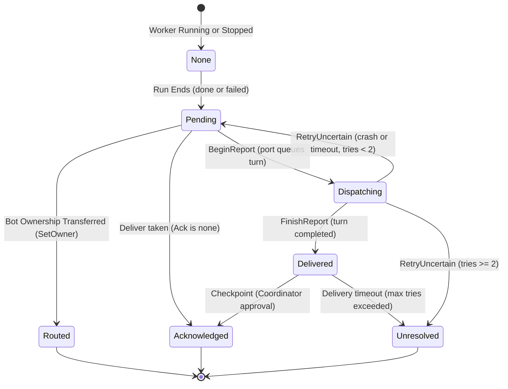
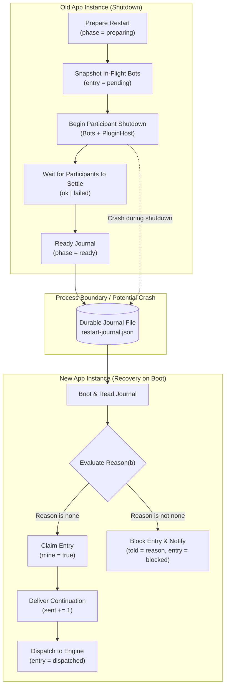

# Architecture Specification: Data Models, State Machines & Formal Verification

## 1. Document Context & Purpose

This specification defines the core data contracts, state machines, invariants, and formal verification models of **Botling**. Specifically, it covers:
1. **`WorkerLedgerRecord` v3**: The canonical durable record for all background and delegated AI worker tasks.
2. **State Projections**: The deterministic mapping functions from core ledger state to UI and subsystem views.
3. **Formal Verification Models (TLA+)**:
   - `Worker.tla`: Concurrency, lifecycle, cancellation, and report handoff invariants.
   - `Restart.tla`: Crash resilience, shutdown continuation journaling, and at-most-once recovery semantics.

---

## 2. Canonical Worker Data Model: `WorkerLedgerRecord` v3

Worker state in Botling is unified under a single source of truth: `<member store>/worker-ledger.json` (`desktop/src/core/worker-core/ledger.ts`). It is written exclusively by `WorkerCore` at state transition boundaries (launch, end, report settlement, owner change, crash recovery) using atomic file writes (`writeFileAtomic`).

```typescript
export interface WorkerLedgerRecord {
  v: 3;
  id: string;                                   // Task UUID
  engine: "claude" | "codex" | "agy";          // Engine runtime
  adapter: "claude-process" | "codex-thread" | "agy-acp" | "component-editor";
  name: string;                                 // Worker label
  instructions: string;                         // Initial prompt instructions
  type: string | null;                          // Subagent classification type
  ownerSessionId: string;                       // Coordinator session ID
  run: number;                                  // Monotonically increasing run count
  segment?: number;                             // Post-restart run segment counter
  status: WorkerStatus;                         // Core status
  report: WorkerReportRecord;                   // Delivery & checkpoint status
  conversationId: string | null;                // Engine-level session/thread handle
  processes: ProcessIdentity[];                 // Tracked PIDs (max 8, sorted oldest to newest)
  owner?: WorkerOwner;                          // Associated owner metadata
  createdAt: number;                            // Creation epoch timestamp
  runStartedAt: number | null;                  // Active run start timestamp
  endedAt: number | null;                       // Termination timestamp
  interruptedBy?: "quit" | "restart" | "crash"; // Reason for interruption
  recovery?: "required";                        // Indicates orphaned process verification needed
  cleanup?: "pending" | "failed";               // Asynchronous process tree cleanup status
  engineData: Record<string, unknown>;          // Engine-private opaque state
}

export interface WorkerReportRecord {
  state: ReportState;                           // Report delivery state
  text: string | null;                          // Final report prose
  status: RunStatus | null;                     // Terminal run outcome
  attempts: number;                             // Delivery attempts to coordinator
  checkpoint?: ReportCheckpoint;                // Checkpoint outcome & evidence
}

export interface ReportCheckpoint {
  outcome: string;                              // Outcome disposition (e.g. accepted, rejected)
  evidence: string;                             // Supporting evidence string
  dependencyTaskId?: string;                    // Associated dependency task ID
}
```

---

## 3. Worker State Vocabulary & Status Projections

The tuple `(status, report.state, cleanup)` uniquely defines the worker state. All external views (`WorkerInfo.state`, `subagents.json`, `agents.json`, and the chat chip) are pure projections (`desktop/src/core/worker-core/status.ts`).

### 3.1 Vocabulary Definitions

| Type | Allowed Values | Semantic Meaning |
|---|---|---|
| `WorkerStatus` | `new` | Initialized record; has never launched a process. |
| | `running` | Child process or engine thread is actively executing. |
| | `done` | Engine exited successfully with a completed result. |
| | `failed` | Engine exited with an error, exception, or non-zero code. |
| | `stopped` | Explicitly aborted by user or coordinator stop command. |
| | `interrupted` | Abnormally terminated by host restart, crash, or SIGKILL. |
| `ReportState` | `none` | No report is owed (while running, stopped, or new). |
| | `pending` | Run ended; report is waiting for coordinator pickup. |
| | `dispatching` | Report is being transferred (e.g. Antigravity `beginReport`). |
| | `delivered` | Coordinator received report; awaiting checkpoint decision. |
| | `acknowledged` | Fully settled (policy `none` at delivery; policy `checkpoint` after review). |
| | `unresolved` | Coordinator exceeded max delivery attempts without deciding. |
| | `routed` | Ownership transferred to another bot; report emitted for routing. |

### 3.2 Projection Matrix



#### Exact Projection Formulas
- **`showsFailed(r)`**:
  $$\text{cleanup} = \text{"failed"} \lor (\text{report.state} = \text{"unresolved"} \land \text{status} \in \{\text{"done"}, \text{"failed"}\})$$
- **`reportOwed(state)`**:
  $$\text{state} \in \{\text{"pending"}, \text{"dispatching"}, \text{"delivered"}\}$$
- **Chat Chip (`chipStatus`)**:
  1. If `showsFailed(r)` $\to$ `failed`
  2. If `status == "running"` $\to$ `running`
  3. If `status == "done"` $\to$ `completed`
  4. If `status == "failed"` $\to$ `failed`
  5. If `status == "interrupted"` $\to$ `interrupted`
  6. Otherwise (`stopped`, `new`) $\to$ `killed`

---

## 4. State Machine Specifications

### 4.1 Worker Lifecycle State Machine



### 4.2 Worker Report Delivery State Machine

The report delivery lifecycle manages handover from the worker to the coordinator conversation. Delivery adheres to one of two policies:
- **`Ack = "none"` (Claude)**: Immediate acknowledgment upon single delivery.
- **`Ack = "checkpoint"` (Codex, Antigravity)**: Coordinator must review evidence and emit an explicit checkpoint (`app_task_checkpoint`) within at most 2 delivery attempts.



---

## 5. Formal Verification with TLA+

Botling's core distributed concurrency protocols are formally specified and verified using TLA+ model checking (TLC).

### 5.1 Worker Lifecycle Protocol (`Worker.tla`)

- **Specification Location**: `spec/models/worker/Worker.tla`
- **Config**: `spec/models/worker/Worker.cfg`
- **Driver / Conformance Test**: `spec/driver/worker-driver.ts`, `spec/tests/worker.spec.test.ts`
- **Real-world Component**: `desktop/src/core/worker-core/core.ts`

#### Model State Variables
- `wk`: Function mapping each worker slot $x \in Workers$ to its record:
  - `status`, `run`, `rep`, `tries`, `queued`, `active`, `cleanup`, `recovery`, `stale`, `op`, `pend`, `owned`.
- `crashes`: Bounded counter ($0 \dots MaxCrash$) of host crash events.

#### Verified Safety Invariants

| Invariant Name | Mathematical Formula | Architectural Guarantee |
|---|---|---|
| **`OneLiveRun`** | $\forall x: wk[x].status = \text{"running"} \implies \neg wk[x].stale$ | No worker starts a new run while a previous process of that worker is still active. |
| **`StaleIsGuarded`**| $\forall x: wk[x].stale \implies (wk[x].recovery \lor wk[x].cleanup = \text{"pending"})$ | Any unconfirmed/stale process forces a cleanup barrier or recovery check before further execution. |
| **`OwedOnlyEnded`** | $\forall x: wk[x].rep \in \{\text{"pending"}, \text{"dispatching"}, \text{"delivered"}\} \implies wk[x].status \in \{\text{"done"}, \text{"failed"}\}$ | Reports are only generated and owed for terminated runs. |
| **`NoFalseFailed`** | $\forall x: wk[x].status = \text{"done"} \land Chip(wk[x]) \neq \text{"completed"} \implies (wk[x].cleanup = \text{"failed"} \lor wk[x].rep = \text{"unresolved"})$ | A successfully completed run never displays as failed in the UI unless its cleanup failed or report was unresolved. |
| **`OneTerminal`** | $[][\forall x: wk[x].status \in Ended \land wk'[x].run = wk[x].run \implies wk'[x].status = wk[x].status]_{vars}$ | A run's terminal status (`done`, `failed`, `stopped`, `interrupted`) is immutable for that run index. |
| **`NoStaleOp`** | Enforces that an asynchronous cancel/stop requested for run $R$ never cancels a subsequent run $R+1$. | Eliminates the critical race condition patched in commit `3910341f`. |
| **`ReportAtMostOnce`**| Enforces delivery limit ($tries < MaxShows$) and verifies reports are never presented after ownership handover. | Prevents duplicate report turns or cross-bot leakages. |

#### Verified Liveness Properties
- **`RunEnds`**: $\forall x: wk[x].status = \text{"running"} \leadsto wk[x].status \in Ended$ (Under weak fairness, any running worker eventually reaches a terminal state).
- **`ReportSettles`**: $\forall x: wk[x].rep = \text{"pending"} \leadsto wk[x].rep \in \{\text{"delivered"}, \text{"acknowledged"}, \text{"unresolved"}, \text{"routed"}, \text{"none"}\}$ (Every pending report eventually settles).

---

### 5.2 Restart Continuation Protocol (`Restart.tla`)

- **Specification Location**: `spec/models/restart/Restart.tla`
- **Config**: `spec/models/restart/Restart.cfg`
- **Driver / Conformance Test**: `spec/driver/restart-driver.ts`, `spec/tests/restart.spec.test.ts`
- **Real-world Component**: `desktop/src/core/restart-continuation.ts`, `Core.prepareRestart`

#### Protocol Mechanics
When the app initiates a restart or experiences a crash, tasks in flight must be either safely resumed or held back with an explicit user notice.



#### Verified Invariants in `Restart.tla`

1. **`AtMostOnce`**:
   $$\forall b \in Bots: sent[b] \le 1$$
   No bot continuation is ever delivered more than once across arbitrary crashes and restarts.
2. **`OnlyRealWork`**:
   $$\forall b \in Bots: sent[b] > 0 \implies (busy[b] \land \neg own[b] \land stop[b] = \text{"ok"})$$
   A bot only resumes if it actually had work in flight, had no internal blocker, and its old instance shut down cleanly.
3. **`ConfirmedOnly`**:
   $$\forall b \in Bots: entry[b] \in \{\text{"claimed"}, \text{"dispatched"}\} \implies phase = \text{"ready"}$$
   No continuation is attempted from an incomplete or unconfirmed journal.
4. **`OthersNeverBlock`**:
   $$\forall b \in Bots: told[b] \neq \text{"none"} \implies Cause(b, told[b])$$
   A failure in one participant (e.g. a plugin host or an unrelated bot) never blocks another cleanly shut down bot.
5. **`BlockedIsTold`**:
   $$\forall b \in Bots: entry[b] = \text{"blocked"} \implies told[b] \neq \text{"none"}$$
   Every held-back task is paired with an explicit reason communicated to the operator.
