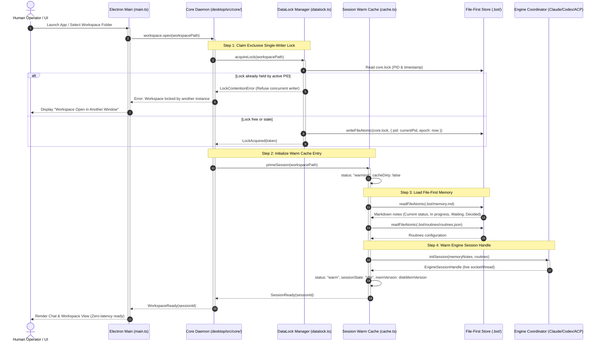
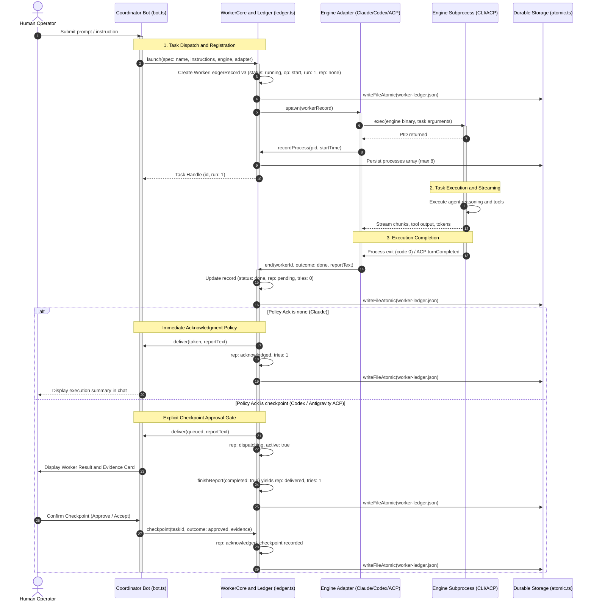

# Architecture Specification: Critical Cross-Boundary Sequences

## 1. Document Context & Purpose

This specification documents the primary cross-boundary runtime sequences in **Botling**:
1. **Startup & Session Warm Cache Flow**: Workspace initialization, single-writer data lock acquisition (`core.lock`), durable `.bot/memory.md` reading, and session warm cache priming.
2. **User Message -> Worker Dispatch -> Checkpoint Flow**: Task delegation, process supervision, report settlement, and checkpoint validation across Coordinator, WorkerCore, and Engine processes.
3. **Permission Gate & Revocation Flow**: Hardened isolation, origin validation, rate limiting, out-of-band human authorization, and scope-based revocation for sandboxed iframe components.
4. **Idle Tidy Memory Consolidation Cycle Flow**: Quiescence detection, memory note maintenance (`.bot/memory.md`), and graceful engine process teardown.

---

## 2. Sequence 1: Startup & Session Warm Cache Flow

This sequence demonstrates how Botling opens a workspace, claims exclusive single-writer locks, initializes the Session Warm Cache from file-first memory, and prepares live engine session handles for zero-latency turn execution.



### Invariants & Guards
- **Single-Writer Safety**: Verified by `BotSessionLifecycle.tla`. A session cannot be warmed or modified without holding `core.lock`.
- **Cache Consistency**: Prior to the first turn, `cacheMem` strictly matches `diskMem`.
- **Memory Budget Enforcement**: If active warm sessions exceed `MaxWarmSessions`, the least-recently-used session is evicted before priming a new workspace.

---

## 3. Sequence 2: User Message -> Worker Dispatch -> Checkpoint Flow

This flow illustrates how a coordinator bot delegates an asynchronous subagent run, supervises its child process tree, captures its report, and settles the checkpoint under the verified `Worker.tla` protocol.



### Key Concurrency Guards
1. **PID Reuse Protection**: The process start time (`processStartTime(pid)`) is paired with every PID in `processes` to prevent signalling or terminating recycled OS PIDs.
2. **Atomic Ledger Updates**: Status mutations are serialized through whole-file atomic writes (`writeFileAtomic`), preventing dirty reads during concurrent engine crashes.
3. **Bounded Delivery**: In checkpoint mode, delivery attempts are strictly limited ($tries < 2$). If the coordinator fails to decide within allowable attempts, `rep` transitions to `"unresolved"`, rendering as a failed card in the UI.

---

## 4. Sequence 3: Permission Gate & Revocation Flow

Interactive cards and third-party plugin panels execute within sandboxed iframes. Untrusted frames are strictly forbidden from initiating privileged commands directly. All requests must traverse the `FrameBroker` gate and the outer `ApprovalSheet` modal, with full support for runtime permission revocation.

```mermaid
sequenceDiagram
    autonumber
    participant Frame as Sandboxed Iframe (origin: null)
    participant FrameBroker as FrameBroker (frame-broker.ts)
    participant CardBroker as CardBroker (broker.ts)
    participant Preload as Preload Bridge (contextBridge)
    actor Operator as Human Operator
    participant ApprovalSheet as ApprovalSheet (UI Modal)
    participant CoreServer as Core Daemon (desktop/src/core/)

    Note over Frame,FrameBroker: 1. Request Phase
    Frame->>FrameBroker: postMessage(ccb: action, name: run, value: cmd)
    activate FrameBroker

    Note over FrameBroker: Security Gate 1: Origin & Window Pinning
    FrameBroker->>FrameBroker: Assert event.origin === "null"
    FrameBroker->>FrameBroker: Assert event.source === target.contentWindow

    Note over FrameBroker: Security Gate 2: Token Bucket Rate Limiting
    FrameBroker->>FrameBroker: checkBucket() (Burst: 20 tokens, Rate: 10/sec)

    alt Invalid Origin or Rate Limited
        FrameBroker-->>Frame: postMessage(ccb: reply, ok: false, error: Refused)
    else Security Checks Passed
        FrameBroker->>CardBroker: forward(target, data)
        deactivate FrameBroker
        activate CardBroker

        CardBroker->>Preload: postCommand(component.command, payload)
        deactivate CardBroker
        activate Preload

        Preload->>CoreServer: IPC: component.command
        activate CoreServer

        Note over CoreServer: Permission Policy Evaluation
        CoreServer->>CoreServer: Check active permissions table (command, folder, ttl)

        alt Active Grant Found (Not Expired / Not Revoked)
            CoreServer->>CoreServer: Execute command in isolated child process
            CoreServer-->>Preload: Execution Result
        else Requires Out-of-Band Human Approval
            CoreServer-->>Preload: Response: needsApproval(ApprovalAskView)
            deactivate CoreServer
            Preload-->>ApprovalSheet: Mount Modal with certified values
            activate ApprovalSheet

            Note over ApprovalSheet,Operator: Out-of-Band Human Authorization
            ApprovalSheet->>Operator: Present certified command, working folder, risks
            alt Operator Denies
                Operator->>ApprovalSheet: Click "Deny / Cancel"
                ApprovalSheet->>Preload: postCommand(component.deny)
                deactivate ApprovalSheet
                activate Preload
                Preload-->>Frame: postMessage(ccb: reply, ok: false, error: "Denied by operator")
            else Operator Grants Permission
                Operator->>ApprovalSheet: Click "Allow for Session" (with TTL)
                ApprovalSheet->>Preload: postCommand(component.approve, certifiedToken)
                deactivate ApprovalSheet
                activate Preload
                Preload->>CoreServer: IPC: component.approve
                activate CoreServer
                CoreServer->>CoreServer: Grant permission (store in approved-commands with TTL)
                CoreServer->>CoreServer: Execute approved command
                CoreServer-->>Preload: Execution Result
                deactivate CoreServer
            end
        end

        Preload-->>Frame: postMessage(ccb: reply, ok: true, value: result)
        deactivate Preload
    end

    Note over Operator,CoreServer: 2. Revocation Phase
    alt Explicit Operator Revocation or Scope Timeout
        Operator->>CoreServer: Revoke permission / Change workspace / Session timeout
        activate CoreServer
        CoreServer->>CoreServer: Invalidate grant token, remove from approved-commands
        CoreServer-->>Preload: PermissionRevokedEvent
        deactivate CoreServer
        Preload-->>Frame: postMessage(ccb: event, name: "permissionRevoked")
    end
```

### Security Architecture Invariants
1. **Opaque Origin Enforcement**: Any `MessageEvent` where `event.origin !== "null"` is immediately rejected. This ensures frames cannot impersonate the host or access local storage/cookies.
2. **Source Identity Pinning**: Messages are authenticated strictly by comparing `event.source` with the target iframe's `contentWindow` recorded during registration. No payload-supplied identity is trusted.
3. **Non-bypassable Approval UI**: The `ApprovalSheet` is rendered by the top-level application shell outside the iframe's DOM tree. A sandboxed card cannot synthetically click or dismiss the approval dialog.
4. **Certified Escalation Arguments**: When `cardApprove` issues `component.approve`, it reads arguments exclusively from the `ApprovalAskView` emitted by the Core server, ignoring any parameters sent by the requesting iframe.
5. **Deterministic Revocation**: Permissions are scoped with TTLs and automatically revoked upon workspace switch, session eviction, or explicit user action.

---

## 5. Sequence 4: Idle Tidy Memory Consolidation Cycle Flow

The Idle Tidy cycle periodically consolidates conversational context into durable workspace notes (`.bot/memory.md`) before terminating idle engine processes to conserve system resources.

```mermaid
sequenceDiagram
    autonumber
    actor Operator as Human Operator
    participant Bot as Bot Instance (bot.ts)
    participant IdleTimer as Idle Timer (scheduleIdle)
    participant Head as AgentHead Process
    participant Storage as Durable Storage (atomic.ts)

    Operator->>Bot: Final conversational prompt for session
    Bot->>Head: Process turn
    Head-->>Bot: Turn completed
    Bot->>IdleTimer: scheduleIdle()

    Note over IdleTimer: Wait for Quiescence Period (e.g. 10 minutes)
    IdleTimer->>Bot: timer expired -> tidyAndSleep()
    activate Bot

    Note over Bot,Head: Maintenance Turn Execution (Hidden from UI)
    Bot->>Head: internal turn: prompts().tidy (maintenance)
    activate Head
    Head->>Head: Extract key decisions and state from session history
    Head->>Head: Consolidate into 4 canonical sections (max 150 lines)
    Head->>Storage: writeFileAtomic(.bot/memory.md, consolidatedNotes)
    Head-->>Bot: Tidy reply: OK
    deactivate Head

    Note over Bot,Head: Graceful Head Teardown
    Bot->>Head: head.finish()
    activate Head

    alt Graceful Exit within 5,000ms
        Head-->>Bot: Process exited
        deactivate Head
    else Exit Timeout
        Bot->>Head: head.terminate(1000) [SIGKILL Process Group]
        deactivate Head
    end

    Bot->>Bot: this.tidying = false; this.updated(); (phase: asleep)
    deactivate Bot

    opt Subsequent User Interaction
        Operator->>Bot: New message arrives
        Bot->>Bot: next(): Spawns fresh AgentHead with updated memory.md
    end
```

### Invariants & Failure Handling
- **Non-interruption of In-Flight Work**: If subagents, monitored background commands, or network outages are detected when the timer fires, `sleep()` immediately aborts and re-arms `scheduleIdle()`.
- **Strict Turn Isolation**: The maintenance turn uses `origin: "tidy"`, suppressing chat chip emissions, whiteboard turn indicators, and audio alerts.
- **Tidy Timeout Boundary**: Tidy runs are bound by `options.tidyTimeoutMs` (default: 5 minutes). If an engine hangs during consolidation, the turn is cancelled with `"stopped"` and the head process is killed.
