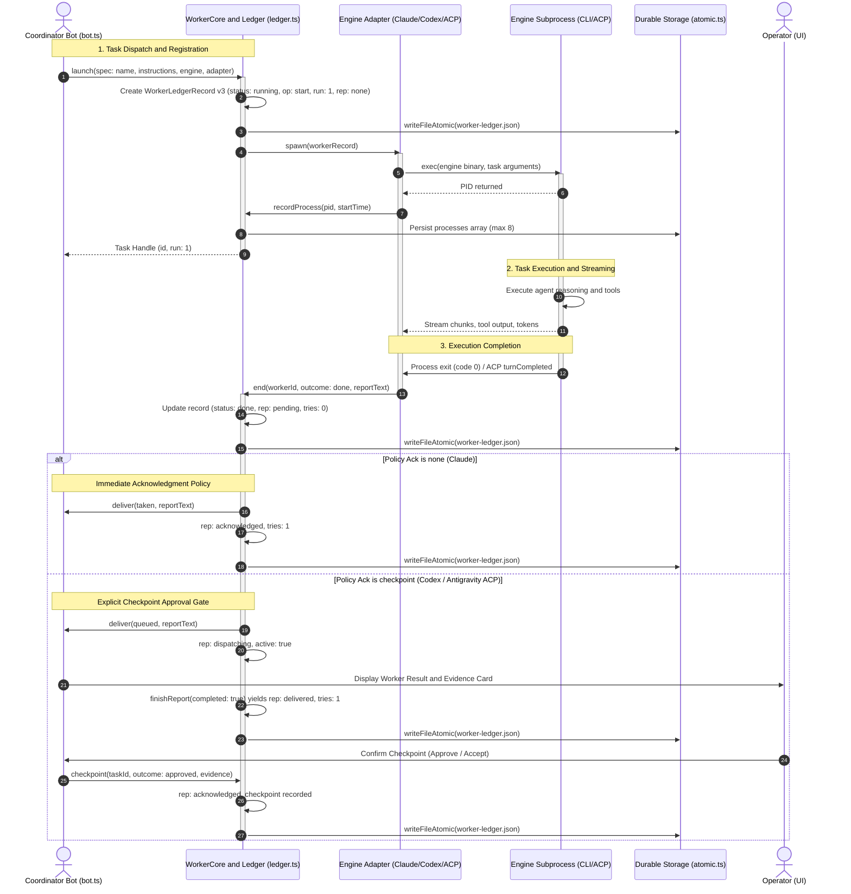
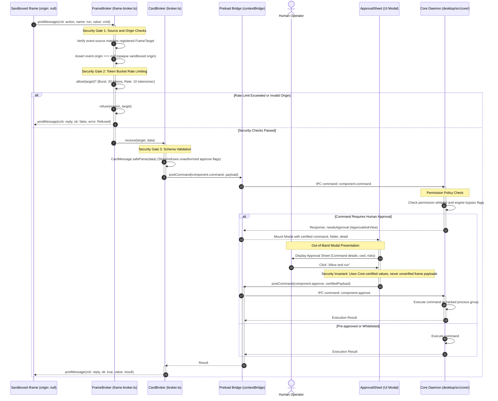

# Architecture Specification: Critical Cross-Boundary Sequences

## 1. Document Context & Purpose

This specification documents the three most critical cross-boundary runtime sequences in **Botling**:
1. **Coordinator/Worker Dispatch-Checkpoint Flow**: Task allocation, process supervision, report settlement, and checkpoint validation across Coordinator, WorkerCore, and Engine processes.
2. **Idle Tidy Memory Consolidation Cycle Flow**: Quiescence detection, memory note maintenance (`memory.md`), and graceful engine process teardown.
3. **Sandbox FrameBroker Permission Approval Gate Flow**: Hardened isolation, origin validation, rate limiting, and out-of-band human authorization for sandboxed iframe components.

---

## 2. Sequence 1: Coordinator/Worker Dispatch-Checkpoint Flow

This flow illustrates how a coordinator bot delegates an asynchronous subagent run, supervises its child process tree, captures its report, and settles the checkpoint under the verified `Worker.tla` protocol.



### Key Concurrency Guards
1. **PID Reuse Protection**: The process start time (`processStartTime(pid)`) is paired with every PID in `processes` to prevent signalling or terminating recycled OS PIDs.
2. **Atomic Ledger Updates**: Status mutations are serialized through whole-file atomic writes (`writeFileAtomic`), preventing dirty reads during concurrent engine crashes.
3. **Bounded Delivery**: In checkpoint mode, delivery attempts are strictly limited ($tries < 2$). If the coordinator fails to decide within allowable attempts, `rep` transitions to `"unresolved"`, rendering as a failed card in the UI.

---

## 3. Sequence 2: Idle Tidy Memory Consolidation Cycle Flow

The Idle Tidy cycle periodically consolidates conversational context into durable workspace notes (`memory.md`) before terminating idle engine processes to conserve system resources.

```mermaid
sequenceDiagram
    autonumber
    actor Operator as Human Operator
    participant Bot as Bot Instance (bot.ts)
    participant IdleTimer as Idle Timer (scheduleIdle)
    participant Head as AgentHead Process
    participant Storage as Durable Storage (atomic.ts)

    Operator->>Bot: Final conversational prompt for session
    Bot->>Head: Process turn
    Head-->>Bot: Turn completed
    Bot->>IdleTimer: scheduleIdle()
    activate IdleTimer

    Note over IdleTimer: Awaits options.idleMs (e.g. 5 minutes) without incoming user messages

    IdleTimer->>Bot: Trigger sleep()
    deactivate IdleTimer
    activate Bot

    Note over Bot: Safety Precondition Verification: 1. Head running, 2. No turns, 3. No approvals, 4. No subagents, 5. No background work, 6. No outage

    Bot->>Bot: this.tidying = true; this.updated(); (phase: tidying)

    Note over Bot,Head: Maintenance Turn Execution (Hidden from UI)
    Bot->>Head: internal turn: prompts().tidy (maintenance)
    activate Head
    Head->>Head: Extract key decisions and state from session history
    Head->>Head: Consolidate into 4 canonical sections (max 150 lines)
    Head->>Storage: writeFileAtomic(memory.md, consolidatedNotes)
    Head-->>Bot: Tidy reply: OK
    deactivate Head

    Note over Bot,Head: Graceful Head Teardown
    Bot->>Head: head.finish()
    activate Head

    alt Graceful Exit within 5,000ms
        Head-->>Bot: Process exited
        deactivate Head
    else Exit Timeout
        Bot->>Head: head.terminate(1000) [SIGKILL Process Group]
        deactivate Head
    end

    Bot->>Bot: this.tidying = false; this.updated(); (phase: asleep)
    deactivate Bot

    opt Subsequent User Interaction
        Operator->>Bot: New message arrives
        Bot->>Bot: next(): Spawns fresh AgentHead with updated memory.md
    end
```

### Invariants & Failure Handling
- **Non-interruption of In-Flight Work**: If subagents, monitored background commands, or network outages are detected when the timer fires, `sleep()` immediately aborts and re-arms `scheduleIdle()`.
- **Strict Turn Isolation**: The maintenance turn uses `origin: "tidy"`, suppressing chat chip emissions, whiteboard turn indicators, and audio alerts.
- **Tidy Timeout Boundary**: Tidy runs are bound by `options.tidyTimeoutMs` (default: 5 minutes). If an engine hangs during consolidation, the turn is cancelled with `"stopped"` and the head process is killed.

---

## 4. Sequence 3: Sandbox FrameBroker Permission Approval Gate Flow

Interactive cards and third-party plugin panels execute within sandboxed iframes. Untrusted frames are strictly forbidden from initiating privileged commands directly; all requests must traverse the `FrameBroker` gate and the outer `ApprovalSheet` modal.



### Security Architecture Invariants
1. **Opaque Origin Enforcement**: Any `MessageEvent` where `event.origin !== "null"` is immediately rejected. This ensures frames cannot impersonate the host or access local storage/cookies.
2. **Source Identity Pinning**: Messages are authenticated strictly by comparing `event.source` with the target iframe's `contentWindow` recorded during registration. No payload-supplied identity is trusted.
3. **Non-bypassable Approval UI**: The `ApprovalSheet` is rendered by the top-level application shell outside the iframe's DOM tree. A sandboxed card cannot synthetically click or dismiss the approval dialog.
4. **Certified Escalation Arguments**: When `cardApprove` issues `component.approve`, it reads arguments exclusively from the `ApprovalAskView` emitted by the Core server, ignoring any parameters sent by the requesting iframe.
