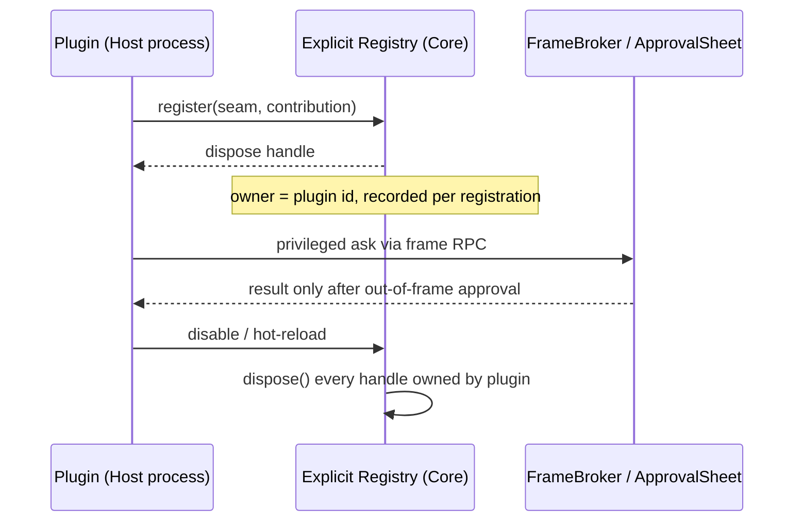

# ADR 005: Plugin Architecture and Core Slimming (Borrow the Seams, Not the Framework)

## Status
- **Status**: Accepted
- **Decided Date**: 2026-11-03 (derived from the 2026-11-02 DeepSeek Harness / Cordis evaluation)
- **Deciders**: Project Lead & Botling Architecture Team
- **Related**: ADR-001 (process topology), ADR-003 (sandboxed frames), ADR-004 (file-first memory), ADR-006 (creator-mode mechanisms)

---

## Context
On 2026-11-01 the project lead supplied `dsh-superagent-prototype` for comparison. It confirmed that Botling already has two-stage Worktree merging and independent sub-agent windows. On 2026-11-02 the lead supplied `deepseek-ai/deepseek-harness` (DSH) and asked Botling to study its "everything is a plugin" philosophy as a way to slim the core.

Forces observed:

1. **Feature code was hard-wired into the core.** Whiteboard, Git review/worktrees, catch-up summaries, usage UI, developer tools, terminal and the board/pins module lived inside `bot.ts`, `server.ts` and `App.tsx`. The research estimates that moving them out removes roughly 9,000–10,000 lines from those three files (an estimate, not a measurement).
2. **DSH's extension model is attractive.** Its extension points are registered at seams instead of editing the core loop; registrations are revocable (`ctx.effect()`); UI uses named slots.
3. **DSH's runtime model conflicts with Botling's security posture.** Cordis is an IoC container whose dependency graph is about 370+ transitive packages (research figure). DSH plugins run in the host process and render into the same DOM as the main UI; its plugin guidance forbids iframes and relies on prompt instructions. A throwing component leaves its slot blank with no automatic rollback.
4. **Botling has non-negotiable invariants** established by earlier ADRs: three-process topology (ADR-001), zero-trust frames plus out-of-frame `ApprovalSheet` (ADR-003), and `WorkerLedger` v3 as the single source of truth (`specs/00-overview.md` §6).

Summary of the Cordis comparison (research figures; the cold-start, memory and size numbers come from the research report and were not independently re-measured for this ADR — **uncertain**):

| Dimension | Cordis IoC | Botling explicit registry |
|---|---|---|
| External dependencies | 370+ transitive packages | 0 added by the registry |
| Type navigation | Declaration merging can show "phantom" services that are `undefined` at runtime | Compile-time go-to-definition |
| Isolation | Single process, shared DOM | Three processes + sandboxed iframe |
| State recovery | State scattered across plugins and closures | Ledger v3, TLA+ checked |
| Dynamic extension | Arbitrary injection points | Declared, fixed slots (accepted limitation) |

---

## Decision
**Borrow the seams, not the framework.** Botling extends itself through an explicit, typed registry with revocable registrations, and moves feature code out of the core into first-party plugins that use the same seams as third-party plugins.

### 1. What we adopt from DSH
- **Extension-point table.** Every capability a plugin may add has a named seam (commands, shortcuts, slash commands, reply tags, prompt sections, views/tiles, main-area tabs, settings sections, chat decorations). Plugins may not patch the core loop.
- **Revocable registration.** Every registration returns a disposer. Disabling or hot-reloading a plugin calls `dispose()` for everything it registered, so no listener, timer, tile or command leaks.
- **Named slots (restricted).** Fixed slots only: main-area tab, sidebar/right panel, bottom panel, settings section, quick settings, chat decoration. No arbitrary DOM injection points.

### 2. What we reject
- **Cordis IoC container / `ctx.inject` resolution.** No dynamic service resolution by string, no declaration merging. Services are obtained through the explicit typed registry (`AppToolsRegistry`, plugin `registry.ts`, `contributions.ts`) so that go-to-definition and compile-time checks keep working.
- **Same-DOM rendering and in-process plugin execution.** Plugin UI stays in `<iframe sandbox="allow-scripts">` with opaque origin (ADR-003); plugin code stays in the Plugin Host process. Host theme CSS variables are injected into the frame to get visual consistency without giving up isolation.
- **Turning the session / agent loop into a plugin.** The multi-engine abstraction (ADR-002), `WorkerCore` and the Ledger stay in the core as a single truth.
- **A micro-package catalog.** Plugins are a static first-party list plus user plugin folders, maintainable by one person.

### 3. Registry and lifecycle contract

Rules:
- A registration is keyed by plugin id; `ownsCommand` (ADR-003) continues to gate command ownership.
- Only a **built-in (first-party)** plugin may take over a core tag or prompt section, and only a built-in plugin may use the privileged `app` seam (e.g. `botling.dev`). User plugins never get it.
- Disposal must be idempotent and safe to call during partial initialisation.

### 4. Eight first-party plugins
The research names eight extraction candidates. Line counts are the research's estimates of code leaving the core.

| Plugin | Scope | Est. lines | Seams needed |
|---|---|---|---|
| `botling.whiteboard` | Whiteboard page, tag parsing, card drawing | ~1,700 | workspace state, main-area tab |
| `botling.git` | Git review, Worktrees, commit/PR | ~1,600 | exec, right panel, `sessions.folder` |
| `botling.catchup` | Unread digest, range summary view | ~1,250 | `messagePosted`, chat decoration |
| `botling.component-studio` | Component Studio, prompt design, spec preview | ~2,300 | `replyTags`, `promptSections` |
| `botling.usage` | Token quota ring, usage cards | ~300 | read-only usage API, settings/sidebar slot |
| `botling.dev` | Botling's own dev tools, install-build, screenshots | ~650 | privileged app API (built-in only) |
| `botling.terminal` | Integrated terminal panel (`node-pty` leaves the core) | ~360 | `spawnPty`, bottom panel slot |
| `botling.board` / pins | Canvas board and floating pins (formerly a chat module) | ~2,500 | tile host container, extension views |

**Status snapshot.** Infrastructure milestones M1–M6 and M11 (ApprovalSheet gate, FrameBroker single-frame RPC, Manifest v3, shortcut table and slash registry, Host API v3, built-in plugin directory) were merged as of the 2026-11-02 research. Git history on this branch additionally shows the following extractions as committed: `botling.whiteboard` (W5/W6), `botling.catchup`, `botling.usage`, `botling.git`, `botling.dev`, and `botling.chat-extras`. `botling.component-studio`, `botling.terminal` and `botling.board`/pins were **not** confirmed as extracted in the sources read for this ADR — **uncertain, verify against `desktop/src/core/plugins/` before relying on it**.

### 5. Invariants kept unchanged
- Zero-trust sandbox: `FrameBroker` origin/token checks, rate limits, command ownership.
- Out-of-frame `ApprovalSheet` with the 350 ms arming delay for any privileged action.
- `WorkerLedger` v3 (`worker-ledger.json`) as the only durable truth for worker state, validated by the TLA+ models.
- Plugin crash blast radius limited to the Plugin Host / frame, not Core or Renderer (ADR-001).

---

## Consequences

### Positive
- **Smaller, clearer core.** `bot.ts`, `server.ts`, `App.tsx` stop hard-coding whiteboard/Git/usage logic (estimated 9–10k fewer lines).
- **One mechanism for first- and third-party extensions**, so first-party plugins double as the test bed for the plugin API.
- **Clean teardown.** Revocable registrations make disable and hot-reload leak-free and testable.
- **No security regression.** Isolation and approval boundaries are untouched; no new runtime dependency.

### Negative & Trade-offs
- **Fixed slots limit what plugins can do.** A plugin cannot hook arbitrary points; new needs require adding a seam to the core. Accepted deliberately.
- **Seam surface grows.** Each extraction may need a new seam (e.g. `sessions.folder`, the privileged app seam) that must be specified, typed and tested.
- **Migration risk.** Moving code risks behavioural drift; each extraction needs its existing tests kept green and the built-in plugin lists updated.
- **Discipline cost.** Contributors must remember to return and call disposers; missing `dispose()` is a leak the type system alone does not catch (a lint/test per seam is recommended — not yet specified).

### Considered Alternatives
- **Adopt Cordis wholesale.**
  - *Rejection Reason*: 370+ package graph, supply-chain surface, phantom services from declaration merging, shared-process memory and no isolation. Suited to chat bots, not a desktop assistant with shell access.
- **Copy DSH's same-DOM plugin rendering for theme consistency.**
  - *Rejection Reason*: A single throwing component can blank a slot or compromise the host. Theme variable injection into sandboxed frames achieves the same look safely.
- **Make Session / AgentLoop plugins too (full "everything is a plugin").**
  - *Rejection Reason*: Would scatter state that the Ledger keeps single and verified; multi-engine abstraction would become implicit.
- **Keep features in the core and only refactor into modules.**
  - *Rejection Reason*: Leaves no uniform lifecycle or isolation story and does not exercise the plugin API with real features.
