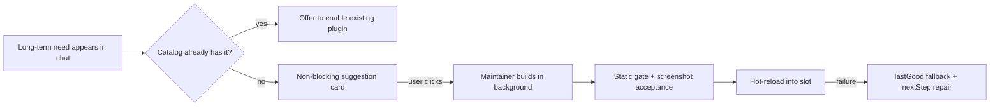

# ADR 006: Creator-Mode Borrowed Mechanisms (Progressive Skills, Read-Only Introspection, Repair Guidance, Suggestion Cards)

## Status
- **Status**: Accepted (direction); individual mechanisms follow the phased adoption list below
- **Decided Date**: 2026-11-03
- **Deciders**: Project Lead & Botling Architecture Team
- **Related**: ADR-003 (sandboxed frames, ApprovalSheet), ADR-005 (plugin architecture)
- **Implementation (2026-11-03, branch `bot/creator-mode-phase1-2`)**: landed M1, M2, M3, M4 (phases 1 and 2). Later on `bot/adr006-rest`: M5 and M6. Not started: role-template retention (deferred by the ADR). Per-mechanism status lines below.

---

## Context
DeepSeek Harness (DSH) ships a "creator mode" (the `cordis` preset) in which the agent extends the product by writing plugin bundles. The research (source read: `deepseek-harness@ce7073d5`; DSH notes dated 2026-09-16/18/21) found that DSH retired its early `node:vm` dynamic define/run tools in September 2026 and converged on: write a standard plugin bundle, request a one-time elevated install, hot-reload it. This matches Botling's direction of unifying first-party and self-built plugins.

The product vision is roughly the same; the runtime safety model is opposite. The decision is therefore **partial borrowing**: take DSH's exploration and entry-point ergonomics, keep Botling's safety net.

| Dimension | DSH creator mode | Botling today |
|---|---|---|
| Artifact | Persistent npm bundle + YAML | Persistent plugin folder with Git version tags |
| Entry | Mode switch, plugin-page menu, suggestion card | "Make into component", `<suggest-component>`, label hand-off to Maintainer |
| API discovery | 2 read-only query tools + progressive skills (3.9 KB index) | One static ~18 KB `PLUGINS.md` (`maintainer-text.ts`) |
| Executor | Any workspace chat switched to cordis mode | Dedicated **Maintainer** guarding the plugin Git repo |
| Isolation | Same process, same DOM | Separate Host process + zero-trust iframe (ADR-003) |
| Reload failure | Old version unloaded, slot blank, no rollback | Automatic fall back to `lastGood`, then hand to repair |
| Acceptance | Syntax-only when no browser control | `component-shot` real screenshot check, up to three auto-fix rounds |

Existing Botling assets this ADR builds on (all named in the research; code locations such as `maintainer.ts`, `spec-desk.ts`, `plugins/` were read there): the Maintainer and SpecDesk, `lastGood` rollback, `component-shot` screenshot acceptance, build-first "Make into component", right-panel multi-round spec refinement, `checkPlugin` in `manifest.ts`, and the planned `botling.component-studio` (ADR-005).

---

## Decision
Adopt six mechanisms. None relaxes the sandbox, `ApprovalSheet`, or the Ledger.

### M1. Progressive creator skills (split `PLUGINS.md`)
- **Status**: Landed. `PLUGINS.md` is an index (`desktop/src/core/plugin-guide-text.ts`); references and templates are written to `plugins-guide/` in the library. Token saving still unmeasured (size only: 18,058 → 2,817 bytes for the first-turn file).
- **Context**: DSH's first layer is a 3.9 KB index with `references/` and `templates/` loaded on demand, deliberately below an 8,192-character tool-result trim limit. Botling's Maintainer reads one ~18 KB guide in full every time.
- **Decision**: Split the guide in `maintainer-text.ts` into a small index plus on-demand reference and template files.
- **Consequences**: Less first-turn context and fewer guesses about slots. The token saving is an inference — **not yet measured**; measure before/after with a real plugin-creation run. Cost: small (docs and tests). Risk: index drift from references; keep a test that every referenced file exists.

### M2. Read-only runtime introspection tools
- **Status**: Landed (final tool list: `slots`, `installedPlugins`, `checkIssues`, `shortcutConflicts`, `themeVariables`). Registered in `plugins/introspect.ts` and reached through `PluginRegistry.inspect`; the Maintainer calls it as `--inspect-plugins` next to `--check-plugin`. The headless-core script variant of the command is not wired.
- **Context**: DSH exposes `cordis_inspect_list` / `cordis_inspect_query` (read-only) instead of stuffing runtime facts into the system prompt, which protects the request-prefix KV cache.
- **Decision**: Give the Maintainer read-only query tools over live Botling state: available slots, outstanding check issues, shortcut conflicts, theme variables, installed plugins. Registered through the explicit registry (ADR-005); no write path, no shell.
- **Consequences**: Fewer wrong-slot guesses; the prompt stays stable. Adds a query surface that must be schema-validated and must not leak secrets (`secrets.ts` data excluded). Cost: small–medium.

### M3. Structured repair guidance (`nextStep`)
- **Status**: Landed. Stable codes and `nextStep` in `manifest.ts` (`CHECK_NEXT_STEPS`, locked by test); `--check-plugin` prints `→ next [CODE]: …` under each `✗` line.
- **Context**: DSH's plugin manager attaches a `nextStep` to every non-success result.
- **Decision**: `check-plugin` and the plugin registry return a status code plus an explicit next action for each failure, as a string mapping.
- **Consequences**: Cheaper, more reliable auto-repair loops, and the same codes can drive UI hints. Cost: minimal. Must keep codes stable (tested), since the Maintainer's behaviour will depend on them.

### M4. Suggestion cards with anti-nag rules and Undo/Restore
- **Status**: Landed in `spec-desk.ts` (`suggestion-rules.ts`), because `botling.component-studio` is not extracted yet; moves with it. Undo takes the component off the bots' lists and Restore puts it back from the library copy (nothing deleted); reverting a later change is still the component's own Revert (git).
- **Context**: DSH's experimental `creation-recommendations` proposes a `create_personalized_page` card; a background Creator is dispatched only after the user clicks. Its skill states anti-nag rules: check the official plugin catalog first, never card a one-off table, at most one card per turn. Cards support Undo/Restore.
- **Decision**: Converge the proposal rules in `botling.component-studio` (`<suggest-component>`): look up existing plugins first, no card for one-shot output, at most one card per turn, and Undo/Restore on created components. Building stays Maintainer-only; background sub-agents never install directly.
- **Consequences**: Less interruption, reversible creation. Needs per-turn state and a restore path (relies on Git tags/`lastGood`). Cost: medium; naturally lands with the Studio extraction (ADR-005).

### M5. Plugins-page creation entry
- **Status**: Landed (`Plugins.tsx` `AskMaintainer`, `plugin-starters.ts`): four starter templates and a description box; it sends a `chat.send` to Maintainer and opens its chat. Placement (top of the Plugins panel) is still to be confirmed with the project lead; only checked by unit test of the request text, typecheck and build, no manual window test.
- **Context**: DSH has a "let the agent create a plugin" menu and sample guidance.
- **Decision**: Add a "Ask Maintainer to build" button with starter templates in `Plugins.tsx`.
- **Consequences**: Discoverability with low risk; it only routes to the existing Maintainer flow. Cost: small (UI). Exact UI placement is **to be confirmed with the project lead** (open item in the research).

### M6. Pre-install static gate
- **Status**: Landed in `manifest.ts` (`staticGate`): new codes `LINK_OUTSIDE_FOLDER` (a symlink resolving outside the plugin folder) and `ICON_TOO_LARGE` (an image file over 512 KB; `node_modules` and `.git` skipped). Panel icons are SF Symbol names, not files, so image files are checked wherever they sit.
- **Context**: DSH runs `validateGeneratedBundle` (path and build checks) before installing.
- **Decision**: Extend `checkPlugin` in `manifest.ts` to reject out-of-bounds links/paths and oversized icon assets before install.
- **Consequences**: Cheap defence in depth ahead of the screenshot check; it complements, not replaces, the sandbox. Cost: small.

### Out of scope / explicitly not adopted
- Role-template generation retention was ranked lowest in the research (high effort, low benefit) and is **deferred**.
- The research did not assess the exact limits of M2's tool set beyond the examples above; the final tool list is **uncertain** and belongs in the implementation spec.

---

## What Botling keeps (and DSH lacks)
- Separate Host process and zero-trust iframe; theme variables injected into the frame for visual consistency.
- `ApprovalSheet` for every privilege escalation (single-use approval, not whole-session elevation, matches DSH's one-time elevation idea).
- Automatic `lastGood` rollback and repair hand-off.
- `component-shot` screenshot acceptance with up to three rounds of auto-fix.
- Build-first "Make into component" and multi-round spec refinement in the right panel.

## Phased adoption

| Phase | Items | Rationale (research ranking) |
|---|---|---|
| 1 – Land first | M1 progressive skills, M3 `nextStep`, M2 read-only introspection | Highest benefit-to-effort in the research (est. effort 0.16–0.36 on a 0–1 scale; estimates, not measurements) |
| 2 – With Studio extraction | M4 suggestion rules + Undo/Restore | Rides on `botling.component-studio` (ADR-005) |
| 3 – Opportunistic | M5 Plugins-page entry, M6 static gate | Low cost, lower urgency |
| Deferred | Role-template retention | Highest cost, lowest benefit |

Open decisions from the research: (a) authorise phase 1; (b) confirm the Plugins-page entry (by the Studio extraction stage).

---

## Consequences

### Positive
- Lower Maintainer context cost and fewer blind guesses (expected; unmeasured).
- Faster, more deterministic repair loops through coded next steps.
- Less nagging and reversible creation via suggestion-card rules.
- No weakening of sandbox, approval, rollback or screenshot acceptance.

### Negative & Trade-offs
- New query surface (M2) and new stable error codes (M3) become contracts that need tests.
- Skill split adds files to keep consistent with the plugin API.
- Benefits are inferred from source reading; no real-model token data exists yet. Measure after phase 1.

### Considered Alternatives
- **Adopt DSH creator mode wholesale** (Cordis container, YAML scripting, same-page slots).
  - *Rejection Reason*: Brings back the unsandboxed, no-rollback model rejected in ADR-005; DSH's own plugin standard forbids iframes and relies on prompt discipline.
- **Keep the single large guide and current entry points.**
  - *Rejection Reason*: Keeps full-guide token cost and runtime guessing; the borrowable ideas are cheap.
- **Resurrect dynamic temporary code (`define`/`run`, `node:vm`-style).**
  - *Rejection Reason*: DSH itself retired it to avoid a second plugin lifecycle; Botling's persistent plugin folder plus Git tags is the single path.
- **Let any chat session act as the creator.**
  - *Rejection Reason*: A dedicated Maintainer keeps responsibility and version control clean.
- **Put runtime facts in the system prompt instead of introspection tools.**
  - *Rejection Reason*: Bloats the prompt and breaks the stable prefix cache.
